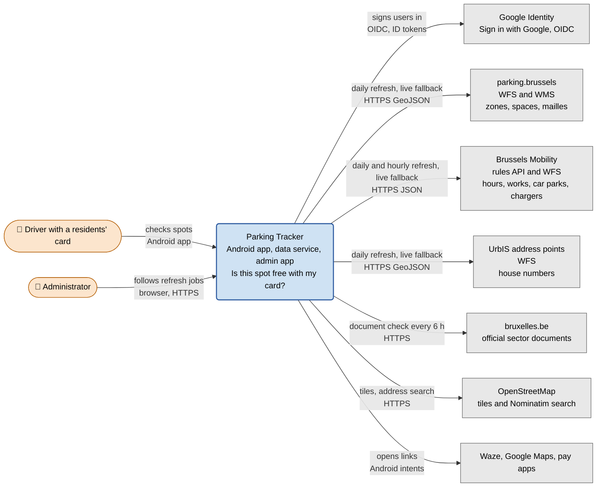
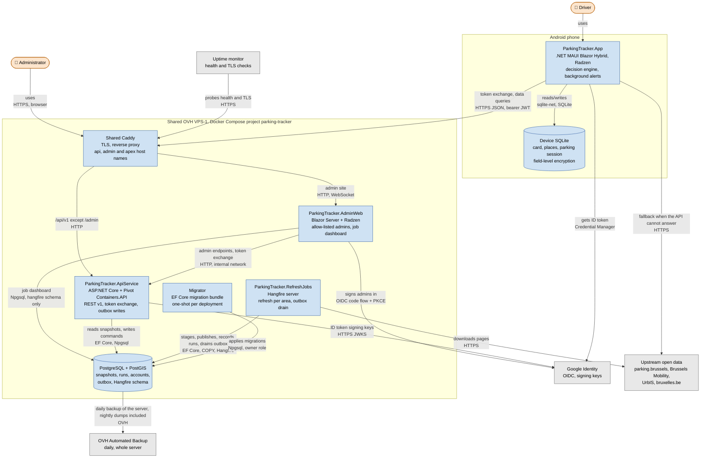
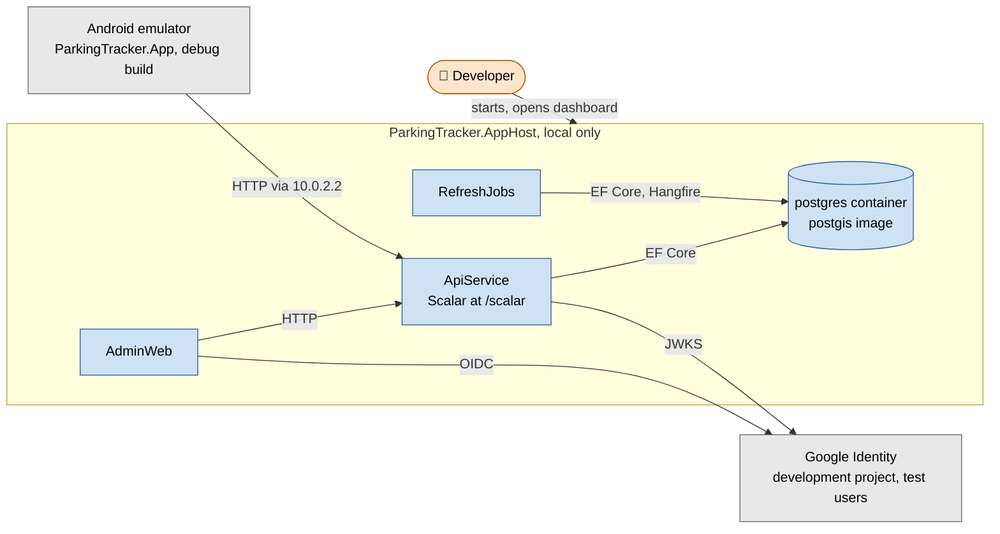
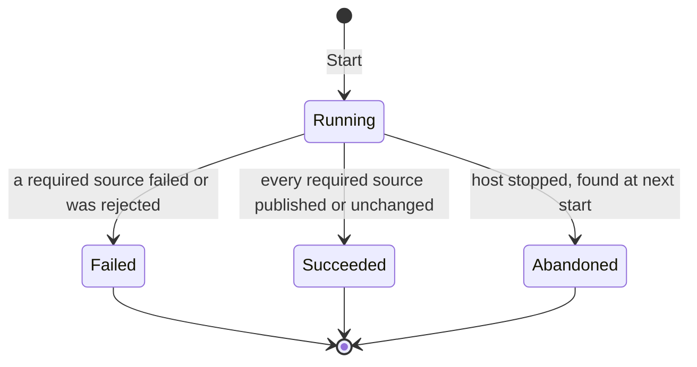
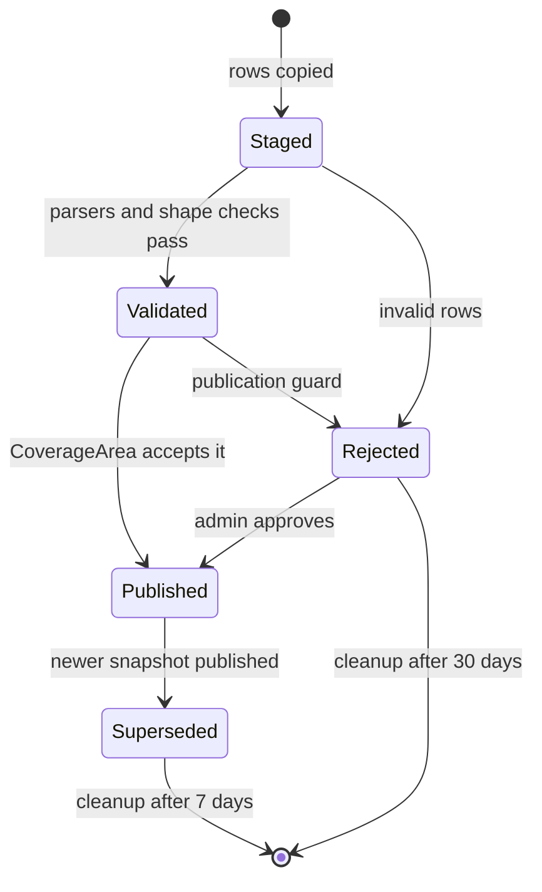
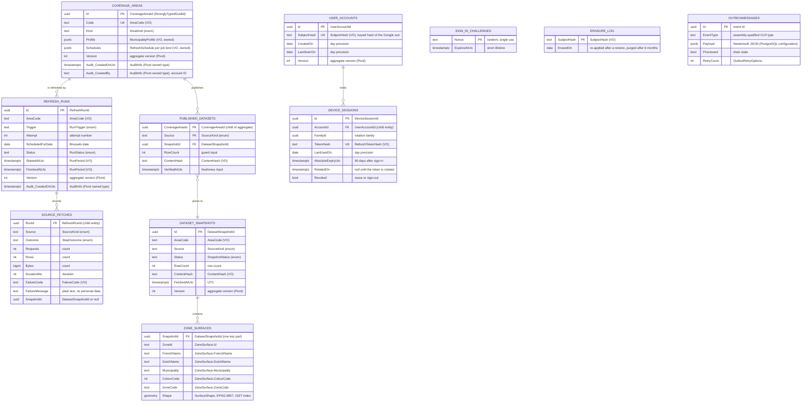
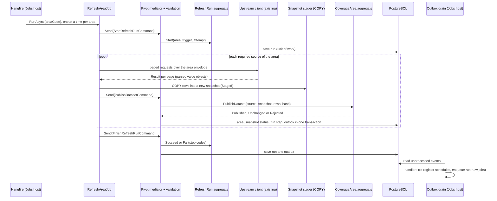
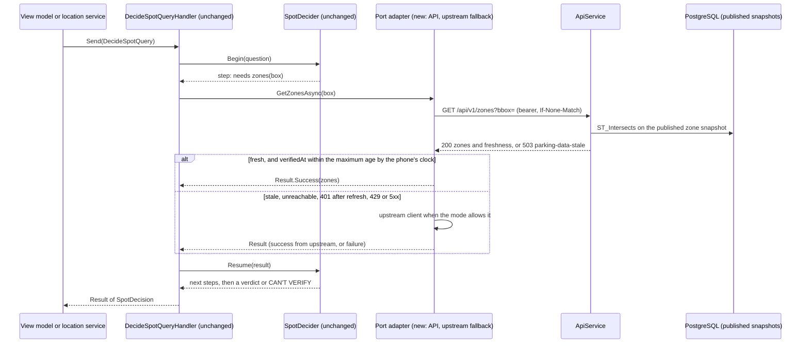
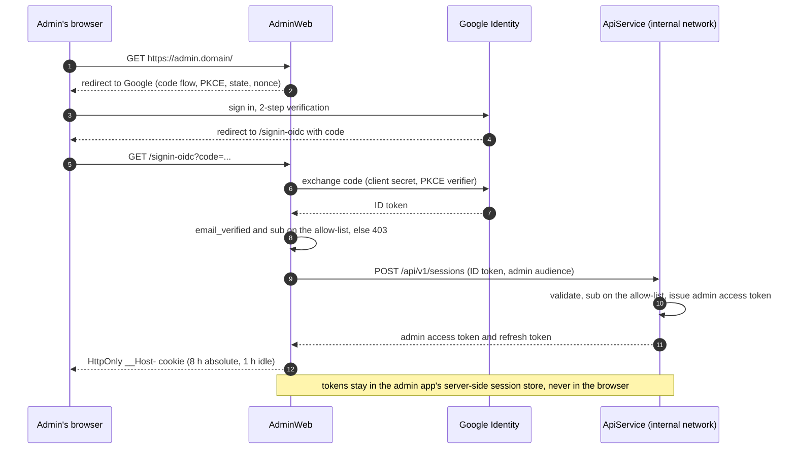
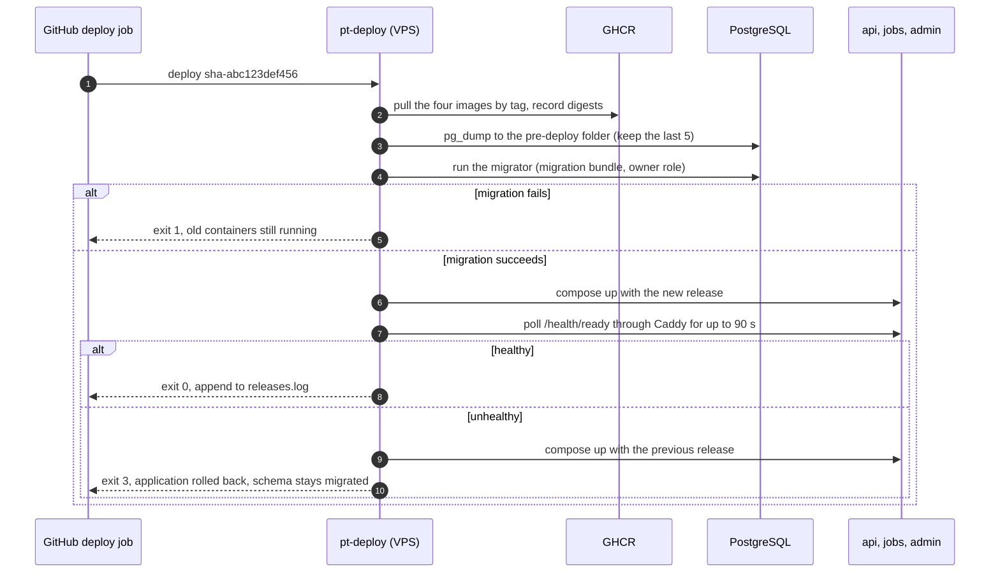

# Parking Tracker architecture v2: parking data service, sign-in, admin app and local database

Status: Accepted (2026-11-17). Nothing on this page is built yet. Each decision is recorded in an Accepted ADR
([ADR-0009](adr/0009-add-a-parking-data-service-and-keep-the-decision-on-the-phone.md) to
[ADR-0025](adr/0025-test-the-api-path-with-api-mode-parity-and-testcontainers.md)). The
implemented design of the Android app is described in [architecture.md](architecture.md); this page describes what
changes on top of it. The two pages are kept apart because one describes a built system and the other a proposal;
they are merged when stage S10 of section 9 ships.

Framework family: Pivot.Framework 2.1.0, selected by the owner. No Bricks package, type or integration is used.

## 1. Scope and inputs

### 1.1 Capability served

Parking Tracker gets a back end. A data service on one OVH VPS becomes the main provider of parking data to the
Android app and is refreshed by scheduled jobs per Brussels municipality. Drivers and administrators sign in with
Google. An admin web app shows the refresh jobs, their failures, durations and the freshness of every dataset. The
driver's own data (card, home, work, parked car) moves into a local database on the phone. The domain gets real
aggregates where something has identity and a lifecycle, and the screens move to Radzen components.

### 1.2 Inputs

There is no separate functional analysis. The owner's requirements and decisions of 2026-11-17 and the current code
are the specification; they are cited here, not restated.

| Ref | Owner requirement | Answered in |
| --- | --- | --- |
| R1 | A back-end API on an OVH VPS becomes the main provider of parking data to the app | 3.2, 5.3, 5.5 |
| R2 | PostgreSQL (PostGIS allowed) | 3.4 |
| R3 | Scheduled jobs refresh the API's data, one job per municipality (19) plus the region-wide sources | 3.6, 5.6 |
| R4 | Google sign-in for drivers and administrators | 3.7, 6.1 |
| R5 | A local database on the phone for the card, home, work and similar data | 3.8, 3.11, 5.8 |
| R6 | An admin web app (Blazor, Radzen) for job runs, failures, durations and freshness; admins only | 3.10 |
| R7 | A domain model with aggregates, entities, value objects and events that keeps the parity-tested logic | 3.13, 5.1, 5.2 |
| R8 | The mobile screens move to Radzen components | 3.12 |

Owner decisions of 2026-11-17 that shape the design (they override the earlier proposals where they differ):

| Ref | Decision | Consequence here |
| --- | --- | --- |
| D1 | Pivot.Framework; PostgreSQL, PostGIS allowed | ADR-0010 |
| D2 | Google sign-in directly, JWT for the API, no Keycloak; account erasure is the app's own endpoint | ADR-0014, a recorded deviation from Pivot's Keycloak-only authentication packages |
| D3 | Sign-in is required in the mobile app | ADR-0015; the app has no signed-out mode |
| D4 | The admin web app is public, protected by Google sign-in and an allow-list of Google account IDs, with hardening | ADR-0017 |
| D5 | The owner's shared OVH VPS-1 (2 vCores, 4 GB RAM), as it is; `<domain>` is `parking.pivotsoftwares.com`; no Backblaze B2 | ADR-0028 (supersedes ADR-0022) |
| D6 | Hangfire with `Hangfire.PostgreSql` directly, because Pivot's scheduling package supports SQL Server only | ADR-0013, a recorded deviation and an upstream Pivot improvement |
| D7 | The remaining open questions take the proposals' recommendations, decided by default | Section 10.2 |

Existing system read for this design: [architecture.md](architecture.md), ADR-0001 to ADR-0008, the solution under
`src/` and `test/`, `README.md`, `Directory.Packages.props`, `nuget.config`, the two workflows in `.github/workflows/`
and the Pivot.Framework source at commit `c6c6bf0` (2026-11-10).

### 1.3 Assumptions

Each assumption changes the design if it is wrong.

| # | Assumption | Impact if wrong |
| --- | --- | --- |
| A1 | At most about 1,000 installs and 100 drivers active at the same time, below 5 API requests per second | Above that: a second API instance, a distributed lock for the outbox drain, a shared cache for sessions |
| A2 | The upstream open-data licences allow redistribution through our API with attribution | Open question Q1. Until it is answered, API-served data is not released to the public (stage S10) |
| A3 | A daily refresh is accurate enough for zones, spaces, mailles, address points and rules; roadworks need an hourly refresh | If zones change during the day without notice, a day-old answer can be wrong; the shadow comparison of stage S6 measures it |
| A4 | The spot decision keeps running on the phone | A server-side decision sends card data and precise positions to the server and changes the privacy analysis (6.3) |
| A5 | The Pivot.Framework source at `c6c6bf0` matches the published 2.1.0 packages | Every API named here is checked against the package assemblies in stage S4 |
| A6 | Android Credential Manager ("Sign in with Google") can be called from the MAUI app through the .NET Android bindings | Stage S5 starts with a spike; the fallback is in the risks (10.1). Confirmed on the emulator by the S5 spike (2026-11-19). |
| A7 | A driver accepts a mandatory Google sign-in, and an upgrade from v1.0.x asks for it once | Fewer active users; the decision is the owner's (D3) |

### 1.4 Evidence gaps

- The installed `pivot-*` skills cover Domain, Application, Infrastructure.Abstraction, dependency injection and
  testing only. The PostgreSQL persistence, EF Core persistence, messaging, Containers.API and scheduling packages
  were read in the Pivot.Framework source instead. Re-run the collection setup with the matching package groups once
  the package references exist.
- The installed `pivot-application` skill still describes MediatR. Pivot 2.x has its own mediator (`AddPivotMediator`),
  which the existing code and ADR-0001 already use. The source wins.
- Not verified yet, each assigned to the stage that first needs it: `Hangfire.PostgreSql` version and compatibility
  with Hangfire 1.8 on .NET 10, Hangfire's `MapHangfireDashboardWithAuthorizationPolicy`, the Credential Manager
  bindings for .NET Android, Radzen inside a MAUI `BlazorWebView`, EF Core start-up time on the emulator, WFS paging
  on each upstream layer, the .NET 10 chiseled image tag with time-zone data and ICU, the real memory use of each
  container against the 1 GB budget of ADR-0028, and Google's current consent-screen requirements.

## 2. Quality attributes

| Attribute | Target | Argued in |
| --- | --- | --- |
| Honesty (dominant) | Never FREE on stale, failed, partial or suspicious data. Every CAN'T VERIFY cause of today stays, and stale or unavailable API data is a new cause | 3.3, 3.15 |
| Freshness | Each dataset verified against its source within its maximum age: 36 h for daily sources, 3 h for roadworks, 7 h for the City documents | 3.3, 5.3 |
| Decision latency | One check within today's per-source timeout (12 s); API p95 under 300 ms server-side for a bounding-box query | 3.4, 5.5 |
| Availability | Best effort, 99 % per month for the API. An API outage degrades to direct upstream calls or CAN'T VERIFY, never to a wrong answer | 3.15, 7.7 |
| Recovery | RPO 24 h for accounts, schedules and run history; parking data is rebuilt from upstream; RTO about 4 h on a new VPS | 7.5 |
| Volume | About 25 k street surfaces, 170 k address points and 150 k on-street spaces per generation; under 2 GB with three generations kept | 3.4 |
| Upstream politeness | At most 2 concurrent requests per upstream host, paged requests, one full pass per area per day | 5.6 |
| Privacy | Card number, plate, home, work and the parked car stay on the phone, encrypted per field. The server keeps a keyed hash of the Google account ID, day-precision activity and run history, and no location history | 3.8, 6.3 |
| Security of the public admin app | Every page and the job dashboard need an allow-listed Google account; brute force and scraping are rate-limited | 3.10, 6.2 |
| Auditability | Every job attempt recorded with its steps, durations, row counts, error codes and the dataset it published | 5.1, 5.6 |
| Parity | The 20 recorded parity scenarios give the same verdicts and texts in upstream mode at every stage, and the same verdicts through the API | 5.2, 6.7 |
| Local verifiability | Domain, Application, Persistence, API, Jobs and Admin build and test on a PC (Docker for the database); Android only in CI, as today | 4.4, 6.7 |

## 3. Architecture decisions

Each decision below gives the options, why the chosen one wins, and the negatives accepted. The full argument is in
the ADR linked at the end of each subsection.

### 3.1 Architecture pattern

**Decision:** Pivot pattern A (outbox CQRS) on the server, with the outbox drained in process by the Jobs host only.
Pattern D (lightweight aggregates and a unit of work, no read models, no events dispatched) for the on-device database.

**Options:** A outbox CQRS; B CQRS with event history; C orchestrated process (sagas); D simple CRUD-style aggregates.

**Why A on the server:** two cross-process reactions need after-commit delivery: an admin changes a schedule or asks
for a run in the API, and the Jobs host must act on it. A gives that with the framework's outbox and no broker. B adds
nothing the `RefreshRun` rows do not already record, and its event history would need upcasting work. C solves
cross-service transactions this system does not have. D gives no reliable after-commit reaction.

**Why D on the phone:** the card, places and parking session have invariants but no asynchronous reaction that the
command handler cannot do. Draining an outbox on the phone needs Pivot's messaging package, which brings
`RabbitMQ.Client` and Quartz into the APK for nothing.

**Accepted negatives:** device aggregates raise no domain events, so a future sync needs its own design; the phone's
unit of work is a small hand-written one over sqlite-net (3.11), not Pivot's.

ADRs: [0012](adr/0012-drain-the-outbox-in-the-jobs-host-without-a-message-broker.md),
[0019](adr/0019-model-aggregates-per-bounded-context-and-keep-the-decision-engine-pure.md).

### 3.2 A data API, with the decision kept on the phone

**Decision:** the API serves parking data with its freshness. The phone keeps the decision engine and asks the API
instead of the upstream services. The existing ports (`IParkingBrusselsClient`, `IAddressPointsClient`,
`IParkingRulesClient`, `IMobilityLayersClient`, the City document check) get a second implementation that calls the
API. The decider, the step runner and the view models do not change.

**Options:** A data API, decision on the phone; B decision API (the phone sends position and card scope, the server
returns a `SpotDecision`); C both, with a decision API for the background alert only.

**Why A:** honesty and privacy dominate. A keeps the parity proof intact by construction, keeps the card and precise
positions off the server, and keeps the background parking alert working as today. B sends the card scope and every
checked position to the server, which would make the server a location history of identified users, and makes every
check depend on the VPS. C has the costs of both and two decision paths to keep equal.

**Accepted negatives:** several requests per decision until the bundle endpoint of stage S11; engine changes still
need an app release; the contract follows the value objects, so a value object change is a contract change.

ADR: [0009](adr/0009-add-a-parking-data-service-and-keep-the-decision-on-the-phone.md).

### 3.3 Versioned snapshots, publication guard and fail-closed freshness

**Decision:** the API stores every parking dataset as an immutable snapshot per coverage area and source, published
only after validation. A dataset older than its maximum age, measured from its last successful verification, is never
served for a decision: the API answers `503` with the problem type `parking-data-stale`, and the app maps it to a
failed source, so the decider answers CAN'T VERIFY as it does today for a failed source. A box that touches a stale
neighbouring municipality near a border also gets `503` (decided by default, 10.2).

**Options:** A versioned snapshots with a publication guard and fail-closed freshness; B overwrite tables in place and
serve whatever is there with an `asOf` field; C serve stale data with a warning flag and let the app decide.

**Why A:** it is the only option in which neither a failed run nor a client bug can produce FREE on bad data. B leaves
mixed data after a half-finished run, and an empty upstream answer would erase the zones and read as "unregulated,
free for everyone". C puts the honesty rule in every client version. The app also checks `verifiedAt` against its own
clock, so a wrong server clock cannot hide staleness.

**Accepted negatives:** storage for several generations and a cleanup job; when a municipality's job keeps failing for
longer than its maximum age, that municipality answers CAN'T VERIFY (or falls back to upstream, 3.15).

ADR: [0011](adr/0011-store-upstream-data-as-versioned-snapshots-with-fail-closed-freshness.md).

### 3.4 PostgreSQL with PostGIS through Pivot

**Decision:** PostgreSQL 17 with PostGIS, through `Pivot.Framework.Infrastructure.Persistence.PostgreSQL`
(`AddPostgreSqlContext<TContext>` and its outbox configuration) on
`Pivot.Framework.Infrastructure.Persistence.EntityFrameworkCore` (`PivotDbContextBase`, `UnitOfWork<TContext>`,
`BaseAsyncCommandRepository`). Geometries are stored in EPSG:3857 as upstream sends them, with GiST indexes. Snapshot
rows are bulk-loaded with Npgsql binary `COPY`.

**Options:** A PostgreSQL with PostGIS geometry columns; B PostgreSQL without PostGIS, GeoJSON text and four
bounding-box columns; C SQL Server, the Pivot default.

**Why A:** D1 fixes PostgreSQL. Between A and B, `ST_Intersects` reproduces the WFS `bbox` semantics the parity
fixtures were recorded with; B's envelope overlap returns a superset and could make the free-spot search pick a
candidate the recorded run never saw. C needs 2 GB of RAM on the VPS and contradicts D1.

**Accepted negatives:** one extension to install and upgrade; NetTopologySuite types in the persistence project only;
the bulk `COPY` bypasses the unit of work (recorded deviation: the rows are immutable facts keyed by a snapshot, and the
snapshot's publication goes through the unit of work).

ADR: [0010](adr/0010-use-postgresql-with-postgis-through-pivot-persistence.md).

### 3.5 Outbox drain, no broker

**Decision:** `AddInProcessMessagePublisher()` and `AddOutboxDraining<ParkingDataDbContext>` in background polling
mode (5 s) in the Jobs host only. The API registers the unit of work and writes to the outbox but does not drain. No
message broker, no integration events, so no `ParkingTracker.IntegrationEvents` project.

**Options:** A in-process publisher with one drainer; B RabbitMQ through Pivot's outbox (the house default); C both
hosts drain the same outbox in process.

**Why A:** there is no second service and no external consumer. One drainer avoids the double processing that Pivot's
polling drain allows, because it has no distributed lock (known framework limitation). B adds a broker to operate for
two processes. C processes the same message twice.

**Accepted negatives:** an admin action reaches the Jobs host after up to one polling interval; if the Jobs host is
down, the action waits (the Jobs host re-synchronises every schedule at start, so nothing is lost). Domain events that
cross the outbox declare the Newtonsoft JSON constructor that keeps their `Id`, so a redelivery is recognisable.

ADR: [0012](adr/0012-drain-the-outbox-in-the-jobs-host-without-a-message-broker.md).

### 3.6 Refresh jobs: Hangfire on PostgreSQL, outside Pivot's scheduling package

**Decision:** Hangfire 1.8 with `Hangfire.PostgreSql` storage (schema `hangfire` in the parking database), one
Hangfire server in the Jobs host with two workers. Recurring jobs are registered with
`IRecurringJobManager.AddOrUpdate<TJob>` and expression-based method calls, in the `Europe/Brussels` time zone. Each
attempt is a `RefreshRun` aggregate (5.1, 5.6).

**Options:** A Hangfire with `Hangfire.PostgreSql`, configured in the Jobs host; B Pivot's `AddHangfireWithDashboard`
and `IRecurringJobService`; C Quartz.NET; D a `BackgroundService` with a cron parser and an own run table.

**Evidence against B** (Pivot.Framework source, commit `c6c6bf0`,
`Src/Infrastructure/Pivot.Framework.Infrastructure.Scheduling/Extensions/HangfireExtensions.cs` and the recurring-job
service next to it):

- `AddHangfireWithDashboard` hard-codes `UseSqlServerStorage`; there is no storage callback, so it cannot run on
  PostgreSQL.
- `IRecurringJobService.CreateJob` hands Hangfire a captured `Func<>`, which Hangfire cannot reliably serialise
  (listed among the framework's known defects).
- `RecurrenceConfig.Daily` always means 00:00 UTC: no staggering and no Brussels time.
- The dashboard filter expects a Keycloak token and checks authentication but no role.
- The only cached package version is 1.1.7, and the project file still says 1.0.0.

**Why A:** B cannot meet D1 and D2. A keeps Hangfire, the house scheduler, with persistent queues, retries,
`DisableConcurrentExecution`, a dashboard and time-zone-aware cron. C has no dashboard and no per-job retry policy.
D re-implements a scheduler, retries and locking.

**Upstream improvement (Pivot):** a storage callback on `AddHangfireWithDashboard`, expression-based recurring jobs
with a time zone, and a dashboard filter that takes an authorization policy. When Pivot ships them, a new ADR can
retire this deviation.

**Accepted negatives:** a community storage package; jobs take only primitive arguments; Quartz stays in the
dependency graph through Pivot's messaging package.

ADR: [0013](adr/0013-run-refresh-jobs-with-hangfire-on-postgresql-outside-pivot-scheduling.md).

### 3.7 Authentication: Google directly, API-issued tokens, no Keycloak

**Decision:** Google is the only identity provider and is used directly.

- **Mobile app:** Android Credential Manager ("Sign in with Google") returns a Google ID token whose audience is the
  API's Web client ID and whose nonce was issued by the API. The app sends it once to `POST /api/v1/sessions`.
- **API:** validates the Google ID token (signature against Google's published keys, issuer, audience, expiry, nonce),
  finds or creates the account, and issues its own short-lived access token (JWT, ES256, 15 minutes) and a rotating
  refresh token (30 days sliding, 90 days absolute, stored hashed). Every other endpoint uses ASP.NET Core JWT bearer
  authentication against the API's own signing key.
- **Admin web app:** ASP.NET Core OpenID Connect against `https://accounts.google.com` (authorization code flow with
  PKCE, confidential client), an HttpOnly cookie, and the allow-list check (3.10). It exchanges the admin's ID token at
  the API for an admin access token that stays on the server.
- **Erasure:** `DELETE /api/v1/me` is the app's own endpoint (6.1).

**Options:** A Google ID token exchanged for API-issued JWTs; B the Google ID token itself as the bearer token; C
Keycloak brokering Google with Pivot's authentication packages; D a full OAuth server of our own (OpenIddict) or a
managed identity service.

**Why A:** the owner ruled out C (D2). B is simpler but a Google ID token lives one hour and the background parking
alert runs in the foreground service, where a silent refresh through Credential Manager is not a supported path; it
would also put Google's token in every request log path and give no server-side sign-out. A refreshes without UI,
supports sign-out and revocation, and keeps the token audience and lifetime under our control. D makes us a general
token issuer with far more surface than one exchange endpoint, or adds a third-party processor of personal data.

**Deviation from Pivot:** Pivot's authentication packages are Keycloak-only (`KeycloakOptions` builds every URL as
`{BaseUrl}/realms/{Realm}/...`, roles come from `realm_access`). Not used: `Pivot.Framework.Authentication.AspNetCore`
(`AddKeycloakAuthentication`, role policies, Redis token caching and revocation), `Authentication.Blazor`
(`AddKeycloakBlazor`), `Authentication.Maui` (`AddKeycloakMaui`, `AddKeycloakHandler`), `Authentication.Hangfire`
(`AddHangfireKeycloakBrowserAuth`), `Authentication.API` (BFF) and `IIdentityProviderAdminService`. Still used: Pivot's
current-user contract, implemented from our own claims, so audit stamps carry the account ID and never an e-mail.

**Accepted negatives:** we own a token signing key, its rotation and a refresh-token store; the exchange endpoint is
security-critical code that we write and test; the deviation is permanent unless Pivot gains a generic OIDC option.

ADR: [0014](adr/0014-sign-in-with-google-directly-and-issue-api-tokens-without-keycloak.md).

### 3.8 Mandatory sign-in, and the driver's data stays on the phone

**Decision:** the app cannot be used signed out (D3). The first start (and the first start after the upgrade from
v1.0.x) shows the sign-in screen after the local data migration. The card, home, work, favourite places, the parked
car and the timer live only in the phone's database. Nothing of them is sent to or synchronised with the server. The
server knows the account (a keyed hash of the Google account ID), its sessions and the day it was last seen.

**Options for what syncs:** A nothing (local only); B an end-to-end encrypted backup of the device database on the
server, keyed on the device; C plain server-side storage of the card and places.

**Why A:** the card and the home and work addresses are the most sensitive data the app holds, and the decision runs
on the phone, so the server has no use for them. B needs key management that survives a lost phone (otherwise the
backup cannot be read), which is the hard part, for a benefit (no re-entry after a new phone) that the card photo scan
already makes cheap. C turns the server into a store of identified home addresses. A future multi-device need would
reopen B in its own ADR.

**Accepted negatives:** a new phone or a reinstall starts empty; the first start needs network and a Google account
with Google Play services; without network nothing can be checked anyway (CAN'T VERIFY), so only the very first
sign-in is newly blocked.

ADR: [0015](adr/0015-require-sign-in-and-keep-the-drivers-data-on-the-phone.md).

**Proposed change (ADR-0032, stage S5A):** on 2026-11-26 the owner asked for the places, the vehicle profile and the
card to follow the account to a new phone. ADR-0032 (Proposed) chooses a fourth option: one profile document per
account, encrypted on the server with a server key (`profile_key`), synchronised with revisions and `If-Match`, the
phone remaining the working copy offline. The parked car and the timer stay on the phone. Until ADR-0032 is accepted
and stage S5A is released, the decision above still describes the running system.

### 3.9 API style and versioning

**Decision:** REST over HTTPS with JSON, controllers on Pivot's `ApiController` (`HandleResult`, `HandleFailure`,
ProblemDetails), `AddPivotApiVersioning()` with the URL segment as the documented form (`/api/v1/...`). The OpenAPI
document comes from Swashbuckle and is checked by a snapshot test. Scalar renders it in Development only (decided
by default, 10.2). Transport records live in `ParkingTracker.Contracts`. Pivot 2.1.0's `WithSwagger` is an option of
`AddKeycloakAuthentication` and needs Keycloak settings, which ADR-0014 excludes, so the API calls Swashbuckle's
`AddSwaggerGen()` itself: the same generator, without Pivot's helper (S4).

**Options:** A REST, URL versioning, Swashbuckle and Scalar; B gRPC (`Pivot.Framework.Containers.Grpc`); C REST with
`Microsoft.AspNetCore.OpenApi` and a generated client.

**Why A:** works through Caddy and from the admin app, readable in Scalar, payloads map one-to-one onto the value
objects. B needs HTTP/2 end to end and gRPC-Web for the admin app. C adds a second OpenAPI generator next to the
Swashbuckle one that Pivot's packages already bring.

**Accepted negatives:** JSON polygons are larger than binary (mitigated by Brotli and gzip and by the bundle endpoint);
no reference page in Production.

ADR: [0016](adr/0016-expose-a-rest-api-versioned-by-url-segment-with-scalar-in-development.md).

### 3.10 Public admin web app

**Decision:** `ParkingTracker.AdminWeb`, Blazor Server with Radzen.Blazor, public at `https://admin.<domain>` (D4).
Every request needs the `AdminOnly` policy: a Google account whose ID (`sub`) is on the allow-list and whose e-mail is
verified. The allow-list is configuration (a secret file), shared with the API, never stored in the repository and not
editable from the app. The allow-list is checked again on every request, so removing an ID takes effect at once. Domain
data and admin actions go through the API's admin endpoints on the internal network; Caddy does not route
`/api/v1/admin/*` from the internet. The Hangfire dashboard is mounted in the admin app at `/jobs`, against the same
storage, with no Hangfire server, behind the same policy. Hardening: rate limiting, security headers, short cookies
(6.2).

**Options:** A public, Google sign-in plus allow-list, hardened; B private, reachable only through an SSH tunnel or a
WireGuard or Tailscale interface; C public with an IP allow-list in Caddy; D the Hangfire dashboard as the only admin
UI.

**Why A:** the owner chose public access (D4). B is stronger but the owner wants to reach it from anywhere without a
tunnel. C breaks on mobile networks and changing addresses. D shows Hangfire jobs, not domain facts (freshness, row
counts, rejected datasets).

**Accepted negatives:** an internet-facing admin surface that must be patched and watched; the security of the admin
role rests on the admins' Google accounts (2-step verification is required by the owner's rule, not enforceable by
the app); an allow-list change needs a restart.

ADR: [0017](adr/0017-build-a-public-admin-web-app-with-google-sign-in-and-an-allow-list.md).

### 3.11 On-device database

**Decision:** SQLite through sqlite-net-pcl, with no EF Core and no Pivot persistence package on the phone. One
hand-written repository per aggregate (`ResidentCard`, `SavedPlaces`, `ParkingSession`, `Vehicle`) maps the aggregate to
row types and back; a small device unit of work commits the staged changes in one `RunInTransactionAsync` call and
returns a `Result`. The schema is versioned in a `schema_version` table and changed by ordered, numbered steps. The card
number, the plate and the coordinates of home, work and the parked car are encrypted per field with AES-GCM; the 256-bit
key is kept in MAUI `SecureStorage` (Android Keystore). The database file, its journal files and the key are excluded
from Android backup. The budget of 8 MB and 300 ms on the API 34 emulator stays.

**Options:** A EF Core and Pivot's EF Core persistence with field encryption (ADR-0018); B sqlite-net-pcl with
hand-written repositories; C keep `SecureStorage` and `Preferences`; D SQLCipher for the whole file.

**Why B:** ADR-0018 chose A behind a budget gate, and the S3 spike (section 9) measured A at +40.09 MB and +827 ms
against +2.84 MB and +97 ms for B. B keeps the aggregates, their invariants and `Result`; only persistence differs from
the server. C has no relational structure for places and sessions and does not meet R5. D needs a licensed or
community native build per ABI.

**Accepted negatives:** hand-written mapping, unit of work and schema steps, each with its own tests; no LINQ provider
beyond sqlite-net's simple single-table queries; the phone and the server use different repository contracts; a
restored backup on a new phone cannot decrypt the fields (the app asks again, as today).

ADRs: [0026](adr/0026-store-the-drivers-data-with-sqlite-net-pcl-on-the-phone.md), superseding
[0018](adr/0018-keep-the-drivers-data-in-an-encrypted-on-device-sqlite-database.md).

### 3.12 Phone screens on Radzen

**Decision:** add Radzen.Blazor to `ParkingTracker.Shared` and rebuild dialogs, forms, buttons, switches, lists,
notifications and the status sheet from Radzen components. The map stays Leaflet in `map.js`. One theme file sets
Radzen's CSS variables to the current colours. The selectors the emulator test reads are kept.

**Options:** A Radzen with Leaflet kept; B Radzen including its Google Maps component; C keep the hand-written HTML and
CSS (ADR-0001).

**Why A:** R8 decides Radzen. B cannot draw the parking.brussels WMS layer and the polygon styling, which are the
product. C contradicts R8.

**Accepted negatives:** a larger APK; bUnit tests need Radzen's JS interop set up explicitly; the look changes.

**Side menu, dialog bridge, layers and back button.** The app keeps one route (`/`), because the Leaflet map is a
singleton that a second route would destroy. The menu button `#menuBtn` in the search bar opens `AppMenu`, a
`RadzenPanelMenu` in a Radzen side dialog (left, mask, 300 px) with Home, Work, the favourite places, My vehicle and
the parking card; `MenuViewModel` supplies the secondary texts ("Not set" or the saved address, vehicle or card line).
In a build that can sign in, the menu is one Account section: an account line at the top (`#menuAccount`: "Sign in",
or "Account" with the short id), a label (`#menuSectionLabel`: "On this phone only" or "Saved with your account"), and
after a divider "Sign out" (`#menuSignOut`) and "Delete account" (`#menuDeleteAccount`, which opens the account sheet
at its confirmation) while signed in. The menu reads the signed-in state when it opens
(`AccountViewModel.RefreshStateAsync`, a local check that shows no error). A tap closes the menu and then opens the
existing dialog, so a Radzen dialog is never open over one of the app's own; Home and Work start the map picker
instead (below). `DialogBridge` joins an `IDialogViewModel` to `DialogService` (`OpenAsync`/`Close`, and `OnClose`
back to the view model's `Close`), so view models stay free of Radzen; every dialog of the app (welcome, card, car,
favourite places, My vehicle) now goes through `DialogService` as a bottom sheet, and `DialogShell` is gone. The
welcome dialog is opened with `Dismissible="false"`: no title bar, close button, mask click, escape key or back
button, so only "Add my parking card" closes it. Layers: the search bar is 1000, the layers popover 1100, the Radzen
mask 1500 and dialog 1501 (`radzen-theme.css`), Radzen's popups 2000, the toast 2100, the map 0. The back button
closes the newest open screen: `IBackNavigation` is a singleton stack that the menu, the bridge register in;
`MainPage.OnBackButtonPressed` dispatches `TryGoBack` into Blazor through `BlazorWebView.TryDispatchAsync` and leaves
the app only when nothing is open.

**Map picker for Home and Work.** Setting a place is a map mode, not a dialog (`PlacePickerViewModel`: Idle, Searching,
Results, Confirming, Saving). The chips of a place that is not set and the menu entries start it; `Home` gives its root
the class `picking`, which hides the bottom sheet, the find button and the right-hand controls, and the top bar becomes
`PlacePickerHeader` (back, "Set home" or "Set work", "Use my position", a search box and the `AddressResults` list).
One match goes straight to the confirm step, several are listed; a pick, the position, a tap on the map or a drag of
the pin moves a separate draggable marker (`map.js` `setCandidate`, reported back as `OnCandidateMoved`) and
`PlaceConfirmBar` shows its label, "Drag the pin to adjust", Cancel and Save, plus Remove when the place is already
saved (a saved place opens with its pin). Nothing is written before Save; Save is disabled outside the Brussels box and
the domain still refuses such a place. The back button closes the list first and then cancels the picker. The old place
dialog is gone.

**My vehicle.** `VehicleDialog` is a `RadzenTemplateForm` in a bottom sheet opened through `DialogBridge`;
`VehicleViewModel` holds the fields and saves through `IVehicleStore` (`DeviceVehicleStore`, which passes the current
year from `TimeProvider` to the domain). The plugs, battery and range show only for an electric vehicle or a plug-in
hybrid and are cleared when the fuel changes; the first rule the domain refuses is shown next to the form
([0031](adr/0031-keep-one-vehicle-profile-on-the-phone.md)).

ADR: [0020](adr/0020-use-radzen-for-the-phone-screens-and-keep-leaflet-for-the-map.md),
[0030](adr/0030-keep-one-map-page-with-a-side-menu-and-dialogs-through-dialogservice.md).

### 3.13 Bounded contexts and project layout

**Decision:** two bounded contexts in one repository. *Parking data* (server): coverage areas, snapshots, refresh runs,
accounts. *Driver assistant* (phone): card, places, parking session and the decision. They share one Domain project,
because the engine's value objects are the language of both, and have one Application project each, so the APK never
carries server handlers and ports.

**Options:** A one Domain, two Application projects; B one Domain, one Application; C two Domain and two Application
projects.

**Why A:** B puts job, admin and repository ports into the APK and into the phone's mediator scan. C duplicates the
value objects the API serialises and the parity relies on.

**Accepted negatives:** the APK carries the server aggregates' types (small, no dependencies); the layout departs from
the single-Application canonical tree.

ADR: [0021](adr/0021-map-the-canonical-layout-to-two-bounded-contexts.md).

### 3.14 Hosting and deployment

**Decision:** the owner's shared OVH VPS-1 (2 vCores, 4 GB, Gravelines), as it is, beside the `pivotsoftwares.com`
website, Delivery Atlas and RaidManager. Docker Compose under `/opt/apps/parking-tracker` with the API, the Jobs host,
the admin app, a one-shot migrator and PostgreSQL with PostGIS, within a memory budget of about 1 GB, behind the
server's shared Caddy (TLS with Let's Encrypt) on subdomains of `parking.pivotsoftwares.com`. Private images in GitHub
Container Registry (decided by default, 10.2), built and smoke-tested in GitHub Actions and deployed over SSH to a
forced command. Backups: OVH's daily server backup and nightly local dumps, restore tested monthly; no off-site copy.

**Options:** runtime A Docker Compose, B systemd services, C single-node k3s; deploy path A push over SSH with a forced
command, B pull by a timer on the VPS, C SSH through Tailscale.

**Why:** Compose gives immutable image digests, rollback by tag and the Dockerfile per host that the house layout asks
for, at about 100 MB of overhead; systemd ties the .NET runtime to the host's packages; k3s is too much for one node.
The forced command gives feedback in the Actions run with a key that can do one thing; pulling needs a registry
token on the VPS and has no feedback; Tailscale is a good later step.

**Accepted negatives:** Docker-published ports bypass the host firewall, so only the shared Caddy publishes ports; a
PostgreSQL major upgrade is a dump and restore; port 22 stays open to the internet for the deploy job; the 1 GB budget
may prove too small in S6; the backups stay with OVH; Parking Tracker shares the server's memory and proxy with four
other workloads.

ADRs: [0028](adr/0028-host-on-the-shared-ovh-server-with-ovh-backups-only.md) (supersedes
[0022](adr/0022-host-on-one-ovh-vps-with-docker-compose-and-off-site-backups.md)),
[0023](adr/0023-deploy-from-github-actions-through-an-ssh-forced-command.md).

### 3.15 Honesty across the network boundary, and the upstream fallback

**Decision:** any non-success outcome of an API call is a failed source for the decider, never FREE and never an
earlier answer: timeout (12 s), connection or TLS failure, `401` that a refresh does not fix, `429`, `5xx`, `503`
stale, an unparseable body, or a `verifiedAt` older than the maximum age by the phone's clock. The data source mode
(`Upstream`, `ApiWithUpstreamFallback`, `Api`) comes from a small configuration document served by the API
(`GET /api/v1/client-config`) and cached on the phone, with a built-in default per release, so the owner can switch
every phone back to the upstream services without a release.

**Options:** A remote-switchable mode with an upstream fallback; B API only; C upstream only (no change).

**Why A:** a single VPS without an SLA must not make the app less available than today, and the licence question (Q1)
must be able to keep public users on upstream data. B makes every VPS outage a CAN'T VERIFY everywhere. C does not meet
R1.

**Accepted negatives:** two data paths stay in the app until a later ADR retires the fallback; the fallback still
sends bounding boxes to the upstream services, as today.

ADR: [0024](adr/0024-fall-back-to-upstream-services-when-the-api-cannot-answer.md).

### 3.16 Left out deliberately

| Left out | Condition that would bring it back |
| --- | --- |
| RabbitMQ or another broker | A second service that consumes events |
| Event history and projections | An audit requirement per change |
| Sagas | A cross-service transaction |
| MongoDB read store | Read volume beyond PostgreSQL |
| Redis | A second API or admin instance |
| gRPC | A non-HTTP client |
| Keycloak | A second identity provider or federated organisations (owner decision D2) |
| Server sync of the parked car and the timer | A need to see the parked car from another phone (ADR-0032 syncs only the profile) |
| Offline answers from cached data | An ADR that decides it (decided by default, 10.2) |
| E-mail alerts | Stage after the admin app's alerts prove useful (decided by default, 10.2) |
| Prometheus, Grafana, Loki | A need that logs, health checks and the admin app cannot cover |

## 4. Component and deployment model

### 4.1 System context

The system, its users and the systems around it. Drivers and administrators sign in with Google; the jobs read the
public data sources daily, and the phone reads them directly only as a fallback.



### 4.2 Containers as deployed

What runs in production: the APK on phones, and the containers on the shared OVH server behind its Caddy. No Aspire
AppHost and no development container appears here. Google, the upstream sources and the uptime monitor are external.
The other applications on the server are left out.



### 4.3 Local development composition (not deployed)

On a developer PC the Aspire AppHost starts PostgreSQL with PostGIS (`postgis/postgis` image) and the three hosts. Sign-in
uses OAuth clients of a separate Google Cloud project for development; the emulator reaches the API through the
emulator's host address. There are two Google Cloud projects. Development has a Web client and an Android client with
the debug key's SHA-1. Production has a Web client and an Android client with the release key's SHA-1. A package and
SHA-1 pair can be registered in one project only. Until S9 both debug and release builds use the development Web
client ID: the development project also holds an Android client with the release key's SHA-1 (added 2026-11-26), so
the owner can sign in from the released APK on a phone. In S9 that client is deleted from the development project and
created in the production project, and release builds switch to the production Web client ID.



The AppHost follows the scaffolding rules: `Properties/launchSettings.json` with `https` and `http` profiles and fixed
dashboard ports, a `UserSecretsId`, secrets as `AddParameter(..., secret: true)` (Google client IDs and the admin
client secret, the PostgreSQL password, the development token signing key), a dashboard link to the Scalar page, and
run instructions in `README.md`.

### 4.4 Solution layout

The canonical Pivot tree, adapted as 3.13 decides. `new` marks a project that does not exist yet; `S4` marks what
stage S4 added.

```text
ParkingTracker.slnx                               everything that builds on a PC (the MAUI host stays out, as today)
deploy/                                           S4   compose.yaml, Caddy block, role SQL, pt-deploy, provisioning
src/
  Containers/
    API/ParkingTracker.ApiService                 S4   ASP.NET Core, Pivot Containers.API, health, Dockerfile, sign-in (S5)
    Jobs/ParkingTracker.RefreshJobs               new  Hangfire server, recurring jobs, outbox drain, Dockerfile
    Aspire/Defaults/ParkingTracker.ServiceDefaults  S4   OpenTelemetry, health checks, resilience (server hosts)
    Aspire/Hosting/ParkingTracker.AppHost         S4   local composition only, never deployed
    UI/
      Core/ParkingTracker.Shared                  phone Razor components (moves to Radzen)
      Core/ParkingTracker.ViewModels              phone view models (adds Account, Places)
      Core/ParkingTracker.Admin.ViewModels        new  admin view models and admin API client interfaces
      Hosting/ParkingTracker.App                  MAUI host (adds sign-in, device persistence wiring)
      Hosting/ParkingTracker.AdminWeb             new  Blazor Server + Radzen, Hangfire dashboard, Dockerfile
  Core/
    ParkingTracker.Domain                         shared: decision engine (unchanged) and the aggregates of both contexts
    ParkingTracker.Application                    phone use cases (existing) and the card, places, session commands
    ParkingTracker.Backend.Application            S5   sessions (S5), refresh pipeline, data queries, admin commands (later)
    ParkingTracker.Contracts                      S5   v1 transport records, no dependencies
  Infrastructure/
    ParkingTracker.Infrastructure                 upstream clients and parsers (jobs and phone fallback),
                                                  the phone's API client, embedded reference data
    ParkingTracker.Persistence.EntityFrameworkCore  S4   ParkingDataDbContext, PostgreSQL + PostGIS, migrations,
                                                  migration bundle Dockerfile
    ParkingTracker.Persistence.Device             new  sqlite-net repositories and rows, field encryption, schema steps
test/                                             mirrors src/, one test project per source project, plus:
  ParkingTracker.E2E.Tests                        emulator and upgrade tests (existing), API-mode scenario added
  ParkingTracker.Api.E2E.Tests                    S4   API (jobs and admin later) against Testcontainers PostgreSQL
  fixtures/                                       parity fixtures (existing) and recorded WFS pages for the jobs
```

No `ParkingTracker.IntegrationEvents` project: nothing leaves the service as a message (3.5). The migrator is not a
project: its image is built from `ParkingTracker.Persistence.EntityFrameworkCore` with
`dotnet ef migrations bundle --self-contained`.

### 4.5 Package references

All `Pivot.Framework.*` packages stay pinned together at 2.1.0 in `Directory.Packages.props`.

| Project | Pivot packages | Other notable packages |
| --- | --- | --- |
| Domain | `Domain` | none |
| Application (phone) | `Domain`, `Application`, `Tools.DependencyInjection` | FluentValidation |
| Backend.Application | `Domain`, `Application`, `Infrastructure.Abstraction` | FluentValidation |
| Contracts | none | none |
| Infrastructure | `Application` (as today) | `Microsoft.Extensions.Http` |
| Persistence.EntityFrameworkCore | `Infrastructure.Persistence.PostgreSQL` (brings `.EntityFrameworkCore`) | `Npgsql.EntityFrameworkCore.PostgreSQL.NetTopologySuite` |
| Persistence.Device | none (Pivot's `Domain` through `ParkingTracker.Domain`) | `sqlite-net-pcl` (brings SQLitePCLRaw 3 and the native SQLite library) |
| ApiService | `Containers.API`, `Infrastructure.Messaging.EntityFrameworkCore`, `Tools.DependencyInjection` | `Microsoft.AspNetCore.Authentication.JwtBearer`, `Scalar.AspNetCore` |
| RefreshJobs | `Infrastructure.Messaging.EntityFrameworkCore`, `Tools.DependencyInjection` | `Hangfire.AspNetCore`, `Hangfire.PostgreSql` |
| AdminWeb | `Tools.DependencyInjection` | `Microsoft.AspNetCore.Authentication.OpenIdConnect`, `Radzen.Blazor`, `Hangfire.AspNetCore`, `Hangfire.PostgreSql` (dashboard only, no server) |
| App (MAUI) | as today, plus the device persistence | `Radzen.Blazor`, the AndroidX Credentials and Google Identity bindings (to verify, A6) |

Deliberately not referenced: `Pivot.Framework.Infrastructure.Scheduling` (3.6) and every `Pivot.Framework.Authentication.*`
package (3.7). `Pivot.Framework.Containers.API` 2.1.0 still brings `Authentication.AspNetCore`, `Authentication.Caching`
(Redis), `RabbitMQ.Client` and `Microsoft.Data.SqlClient` as transitive dependencies (seen in S4); nothing calls them,
and ADR-0014's "not used" holds. Splitting them out of Containers.API is an upstream question for Pivot.Framework.

## 5. Data and integration design

### 5.1 Domain model

Not everything becomes an aggregate. What the upstream services publish (a street surface, a rule, an address point)
are facts without identity in this system: they stay value objects, and the decision engine stays a set of pure
domain services over them. Aggregates appear where something has identity and a lifecycle that we own.

#### Parking data context (server)

| Aggregate | Root and children | Invariants | Domain events |
| --- | --- | --- | --- |
| `CoverageArea` (`AggregateRoot<CoverageAreaId>`) | `AreaCode`, `AreaKind` (Municipality, Region), `MunicipalityProfile` (names, `MunicipalityKind`, UrbIS code, prefixes, lims; municipalities only), `RefreshSchedule` per job kind, child entities `PublishedDataset` (one per `SourceKind`) | One published dataset per source; the required source set follows the kind; a new dataset is accepted only within the `PublicationGuard` of the current one; `VerifiedAtUtc` only moves forward; freshness is computed, never stored | `CoverageAreaScheduleChangedDomainEvent`, `RefreshRequestedDomainEvent`, `DatasetPublishedDomainEvent`, `DatasetVerifiedUnchangedDomainEvent`, `DatasetRejectedDomainEvent`, `OfficialListChangedDomainEvent` |
| `RefreshRun` (`AuditableAggregateRoot<RefreshRunId>`) | area code, `RunTrigger` (Scheduled, Manual, Retry), attempt number, `ScheduledForDate`, status, `RunPeriod`, child entities `SourceFetch` (source, requests, rows, bytes, duration, `StepOutcome`, `FailureCode`, message, snapshot ID) | Status machine (diagram below); a run finishes once; `Succeeded` needs every required source published or verified unchanged; a failed step carries a code; durations come from the injected `TimeProvider` | `RefreshRunStartedDomainEvent`, `RefreshRunSucceededDomainEvent`, `RefreshRunFailedDomainEvent` |
| `DatasetSnapshot` (`LightweightAggregateRoot<DatasetSnapshotId>`) | area, source, fetched at, `ContentHash`, row count, `SnapshotStatus` | Staged rows are immutable; only the `CoverageArea` decides publication, the snapshot records it | none |
| `UserAccount` (`AggregateRoot<UserAccountId>`) | `SubjectHash`, created on (day), last seen on (day), child entities `DeviceSession` (family ID, refresh token hash, created, last used day, absolute expiry, revoked) | One account per subject hash; at most 5 active sessions (the oldest is revoked); a refresh token is used once, and reuse of a rotated token revokes its whole family; last seen is rounded to the day; erasure deletes the account and its sessions (hard delete, no soft delete) | none dispatched (sign-in, refresh and erasure finish in their command) |

The snapshot rows (`zone_surfaces`, `reserved_spaces`, `sector_mailles`, `address_points`, `parking_rules`, `works`,
`car_parks`, `charging_points`, `official_documents`) are not aggregate state. They are immutable facts keyed by
`DatasetSnapshotId`, written by `COPY` and read by queries, in the shapes of the existing value objects.

`CoverageArea.GetFreshness(SourceKind, DateTimeOffset now, FreshnessPolicy)` returns `Fresh`, `Stale(age)`,
`Failing(age, lastFailure)` or `Missing`. `FreshnessPolicy` holds one `MaxAge` per source (5.3), is loaded from
configuration and validated at start.

Illustrative only (C#, Pivot 2.1.0 types, not a scaffold; headers and regions omitted):

```csharp
public Result PublishDataset(SourceKind source, DatasetSnapshotId snapshot, int rowCount, ContentHash hash,
    DateTime verifiedAtUtc)
{
    var current = _datasets.SingleOrDefault(dataset => dataset.Source == source);
    if (current is not null && current.ContentHash == hash)
        return current.MarkVerified(verifiedAtUtc);

    var guard = PublicationGuard.Check(current?.RowCount, rowCount);
    if (guard.IsFailure)
    {
        RaiseDomainEvent(new DatasetRejectedDomainEvent(Id.Value, source.ToString(), snapshot.Value, guard.Error.Code));
        return guard;
    }

    ReplaceOrAdd(PublishedDataset.Create(source, snapshot, rowCount, hash, verifiedAtUtc));
    RaiseDomainEvent(new DatasetPublishedDomainEvent(Id.Value, source.ToString(), snapshot.Value, rowCount));
    return Result.Success();
}
```

#### Driver assistant context (phone)

| Aggregate | Root and children | Invariants | Replaces |
| --- | --- | --- | --- |
| `ResidentCard` (`LightweightAggregateRoot<ResidentCardId>`) | `MunicipalityCode`, optional `SectorCode`, `CardPeriod`, mailles, lims, tolerance codes, `CardNumber` and `LicencePlate` (encrypted) | Valid from before valid to; a sector only for a street-list municipality; mailles only for a maille municipality and only with its prefixes; lims only from the municipality's list; plate in capitals; `ToParkingCard()` returns the existing `ParkingCard` record | `pt.card` |
| `SavedPlaces` (`LightweightAggregateRoot<SavedPlacesId>`, one per device) | child entities `SavedPlace` (`PlaceKind`: Home, Work, Favourite; label; `GeoPoint`, encrypted; address text) | At most one Home and one Work; at most 20 favourites; a point must be inside the Brussels box | new (R5) |
| `ParkingSession` (`LightweightAggregateRoot<ParkingSessionId>`) | position (encrypted), parked at, decision headline, optional `ParkingTimer` | One open session; a timer between 5 and 1,440 minutes, after the parking moment; `End()` closes it; `ToParkedCar()` keeps the shape the view models use | `pt.car`, `pt.timer` |
| `Vehicle` (`LightweightAggregateRoot<VehicleId>`, one per device, ADR-0031) | make code from `VehicleMakes`, model, model year, `FuelType`, `EuroNorm`, `ChargingConnector` set, battery kWh, range km, optional `LicencePlate` (encrypted, apart from the card's plate) | Make from the curated list or "Other"; model at most 60 characters; year from 1950 to the current year plus one (the caller passes the year); plugs, battery (1 to 250 kWh) and range (10 to 1,000 km) only for an electric car or a plug-in hybrid; `Create`, `Update`, `Restore`; `ToDetails()` returns the `VehicleDetails` record | new |

The device database also holds a single `DeviceOwner` row (a SHA-256 hash of the signed-in Google account ID, 5.8).
Device settings with no invariant (layer switches, alerts switch, welcome seen, permission snooze) stay in
`Preferences`.

#### Value objects and services that stay as they are

`GeoPoint`, `GeoBox`, `SurfaceShape`, `HouseNumber`, `HouseRange`, `SideRule`, `RuleSet`, `StreetRules`,
`SectorDefinition`, `ToleranceAgreement`, `Municipality`, `ZoneSurface`, `ParkingRule`, `SectorMaille`,
`AddressPoint`, `ReservedSpace`, `WorkItem`, `DecisionContext`, `SpotQuestion`, `DecisionStep`, `SpotDecision`,
`Verdict`, `ParkingDetector`, and the services `SpotDecider`, `AreaDecider`, `SurfaceStatusEvaluator`,
`SpotAnnotator`, `AddressAssigner`, `SectorModel`, `ZoneClassifier`, `PaidHours`, `BelgianHolidays`, `TariffText` and
`CardScopeEvaluator`. They are correctly modelled as value objects and stateless domain services; changing them would
risk parity for no modelling gain.

#### Domain type catalogue

| Type | Kind | Rule |
| --- | --- | --- |
| `CoverageAreaId`, `RefreshRunId`, `DatasetSnapshotId`, `UserAccountId`, `DeviceSessionId`, `ResidentCardId`, `SavedPlacesId`, `ParkingSessionId`, `VehicleId` | `StronglyTypedGuidId<T>` | Never `Guid.Empty`; one type per aggregate or entity; an EF value converter each on the server, mapped by hand to a row column on the phone (ADR-0026) |
| `AreaCode` | value object | Lower-case slug from the municipality IDs of the reference data, plus `region`; unique |
| `SourceKind` | enumeration | Zones, Spaces, Mailles, AddressPoints, Rules, Works, CarParks, Chargers, CityDocuments |
| `RefreshSchedule` | value object | Cron expression in Europe/Brussels, enabled flag |
| `PublicationGuard` | value object and policy | Rejects zero rows, and a drop of more than 20 % against the published count (per source, configurable) |
| `ContentHash` | value object | SHA-256 of the canonical rows, 64 lower-case hex characters |
| `FreshnessPolicy`, `Freshness` | value objects | Maximum age per source; result of the evaluation |
| `RunStatus`, `RunTrigger`, `StepOutcome`, `SnapshotStatus` | enumerations | See the state diagrams |
| `FailureCode` | value object | Dotted code, the same codes as the clients (`ParkingBrussels.Timeout`, `Refresh.GuardRejected`) |
| `SubjectHash` | value object | HMAC-SHA256 of issuer and Google `sub` with a server key, 64 hex characters |
| `RefreshTokenHash` | value object | SHA-256 of the 256-bit random refresh token; the token itself is never stored |
| `MunicipalityCode`, `SectorCode` | value objects | Known in the reference data |
| `CardNumber`, `LicencePlate` | value objects | Trimmed; plate in capitals; persisted encrypted; `LicencePlate` is shared by the card and the vehicle |
| `PlaceKind` | enumeration | Home, Work, Favourite |
| `FuelType`, `EuroNorm`, `ChargingConnector` | enumerations | Stored as their numbers, never renumbered (ADR-0031) |
| `VehicleMakes` | curated list | Stable lower-case make codes with brand names, "Other" last; a code is never renamed or removed |

Domain event payloads use primitives (Guid, string, int, UTC DateTime) and declare the Newtonsoft constructor that
keeps `Id` and `OccurredOnUtc`. There are no integration events.

#### State of a refresh run

A run starts, then succeeds, fails, or is found abandoned after a host crash.



A Hangfire retry starts a new `RefreshRun` with the same `ScheduledForDate` and the next attempt number, so every
attempt stays visible.

#### State of a dataset snapshot

A snapshot is staged, validated and either published or rejected; a rejected snapshot can be approved by an admin.



### 5.2 Keeping the parity-tested engine

Rules for every step: refactoring commits are separate from behaviour commits; the parity suite
(`test/fixtures/parity`, 20 scenarios), the domain tests and the emulator test stay green at every commit; no type the
parity tests touch is renamed or reshaped.

1. **Add, do not replace.** The aggregates are new types in new feature folders (`Features/ResidentCards`,
   `Features/SavedPlaces`, `Features/ParkingSessions`, `Features/CoverageAreas`, `Features/RefreshRuns`,
   `Features/DatasetSnapshots`, `Features/Accounts`). The engine's folders do not move.
1. **Bridge through value objects.** `ResidentCard.ToParkingCard()`, `ParkingSession.ToParkedCar()` and
   `CoverageArea.ToMunicipality()` produce the records the engine and the view models already use. A characterisation
   test per bridge proves that a card read from `pt.card` JSON through the aggregate yields the same `ParkingCard`, and
   that every parity scenario gives the same answer with a card built that way.
1. **Switch callers behind the ports.** `ISettingsStore` gets a database-backed implementation; the view models keep
   the port. The key-value implementation stays until the data migration (5.8) has shipped once.
1. **Reuse the parsers on the server.** The jobs call the existing `ZoneSurfaceParser`, `ReservedSpaceParser`,
   `SectorMailleParser`, `AddressPointParser`, `ParkingRuleParser`, `WorkItemParser`, `CarParkParser` and
   `ChargingPointParser`; the API serialises their output into `ParkingTracker.Contracts` records that mirror the value
   objects field by field; the phone's adapter maps them back. The API-mode parity test (6.7) proves the round trip.
1. **Not migrated:** the decider's `Func<>`-based `DecisionStep` chain, the sentence texts and the
   `OfficialListStatus` logic. They are pure and tested; only the source of their inputs changes.

### 5.3 Data ownership and freshness

| Data | Owner after the change | Refresh | Maximum age for a decision | When the job fails |
| --- | --- | --- | --- | --- |
| Street surfaces, zone colour, municipality | API, per municipality | daily | 36 h | Previous snapshot served until 36 h, then `503` stale and CAN'T VERIFY ("Parking data for Ixelles is out of date") |
| Reserved on-street spaces | API, per municipality | daily | 36 h | same |
| Mailles and the card-form options | API, per municipality | daily | 36 h | same; the card form shows "options unavailable" |
| Address points | API, per municipality | daily | 36 h | same |
| Paid days, hours, tariffs | API, region | daily | 36 h | The engine's rule "rules unavailable, assume paid hours" stays; staleness gives CAN'T VERIFY |
| Roadworks and traffic events | API, region | hourly | 3 h | Note omitted with "roadworks unknown", as today when the source fails |
| Car parks, EV charging points | API, region | daily | 7 days (map layers only) | Shown with an "as of" date; never used for a verdict |
| City of Brussels sector documents (fingerprints) | API, `bruxelles` area | every 6 h | 7 h | `OfficialListStatus.Unverified`; City answers stop, as today |
| City street lists, tolerance lists, municipalities | Embedded JSON in the app (as today); served with a version from stage S11 | on change (Python tools) | n/a | n/a |
| Paid-now evaluation, holidays, Brussels time | Phone, computed | at every check | n/a | n/a |
| Map tiles (OpenStreetMap), zone WMS image | Phone, live (tile policies forbid proxying without agreement) | live | n/a | map without background |
| Address search (Nominatim) | Phone, live, only the typed text | live | n/a | "search unavailable" |
| Position, GPS accuracy, connectivity | Phone | live | ±25 m, 15 s (unchanged) | CAN'T VERIFY (unchanged) |
| Card, places, parked car, timer | Phone only (3.8) | user edits | n/a | n/a |
| Account, sessions | API | at sign-in and refresh | n/a | n/a |

Every data response carries `freshness`: the overall status and one entry per coverage area the box touches
(`areaCode`, `source`, `verifiedAt`, `status`). A box that touches any area whose dataset is not fresh gives `503`.
The phone's adapter adds two failure codes, `ParkingApi.Unavailable` and `ParkingApi.Stale`, which the engine treats
like any other failed source.

### 5.4 Data model

The server tables, annotated with the domain type each column maps to. The snapshot row tables are shown once
(`ZONE_SURFACES`); the others follow the same pattern.



`DEVICE_SESSIONS` holds one row per issued refresh token. A token whose row has `RotatedOn` set has been used, so
presenting it again is a reuse and revokes the family. `SIGN_IN_CHALLENGES` holds the nonces of 6.1: a nonce is
consumed atomically with `DELETE ... RETURNING` after the Google signature check, and expired rows are purged when a
challenge is created. The nonces are in the database, not in memory, so a deployment during a sign-in does not lose
them.

Hangfire's tables live in the schema `hangfire` and are managed by `Hangfire.PostgreSql`. The inbox table that
`AddInboxSupport` creates holds the idempotency keys of "run now" (5.5). Database roles (7.2): `pt_owner` owns the
schema and runs migrations; `pt_api`, `pt_jobs` and `pt_admin_hangfire` get only the rights their host needs.

### 5.5 API contract outline (v1)

Base `https://api.<domain>/api/v1`. JSON, camelCase. Bounding boxes in EPSG:4326 as `minLon,minLat,maxLon,maxLat`,
validated to lie inside the Brussels box with a maximum size; geometries returned in EPSG:3857 as upstream sent them.
Errors are ProblemDetails from `ApiController`. Data responses carry `ETag` (hash of the snapshot IDs served) and
`Cache-Control: private, max-age=300`; `If-None-Match` gives `304`. Brotli and gzip on. The OpenAPI document
(`/swagger/v1/swagger.json`) is the contract; a committed snapshot `openapi.v1.json` is compared in a test.

| Method and route | Who | Answer |
| --- | --- | --- |
| `GET /me/profile` (S5A, ADR-0032) | signed-in driver, rate limit `profile` (token bucket per account) | the decrypted profile document with a strong `ETag` = revision in quotes (`"3"`) and `Cache-Control: private, no-cache`; `304` for a matching `If-None-Match` (weak tags, lists and `*` accepted); `404` when there is none; `500` without a cause when the stored profile cannot be decrypted |
| `PUT /me/profile` (S5A, ADR-0032) | signed-in driver, rate limit `profile` | body: the profile document (32 KB of plain text at most, 40 KB of body: `413` above); `If-Match` with the revision in quotes, or `If-None-Match: *` to create; `428` without either, `400` for a malformed or contradictory header or an invalid document, `412` on a stale revision, on a create over an existing profile or on a lost race (two concurrent creates give one `200` and one `412`); `200` with the new `ETag` and the body `{"revision": n}` |
| `POST /sessions/challenges` | anonymous, rate-limited per IP (one bucket of 10 per minute shared with `POST /sessions`) | a one-time nonce, valid 5 minutes |
| `POST /sessions` | anonymous, rate-limited per IP | body: Google ID token; answer: access token, refresh token, expiry; `401` when the token is invalid |
| `POST /sessions/refresh` | anonymous (holder of a refresh token), rate-limited per IP, a policy of its own: 30 per minute | body: refresh token; answer as `POST /sessions`; one generic `401` for an unknown, revoked, expired or reused token, and a reuse revokes the family |
| `DELETE /sessions/current` | signed-in user | sign-out: revokes the session family named in the `sid` claim of the access token (`204`, also when it is gone); access tokens already issued work until they expire |
| `GET /me` | signed-in user | account ID, created on, last seen on, active session count |
| `DELETE /me` | signed-in user | erasure (`204`, also when the account is gone), see 6.1; the old access token then fails on `GET /me` with `401` |
| `GET /client-config` | signed-in user | data source mode, minimum supported app version, freshness limits |
| `GET /zones?bbox=` | signed-in user | street surfaces and `freshness`; `503` `parking-data-stale` |
| `GET /reserved-spaces?bbox=` | signed-in user | spaces and `freshness` |
| `GET /mailles?bbox=`, `GET /mailles/options?municipality=` | signed-in user | mailles and `freshness`; card-form options |
| `GET /address-points?bbox=` | signed-in user | address points and `freshness` |
| `GET /parking-rules?code=` | signed-in user | rules by code (all when omitted) and `freshness` |
| `GET /works?bbox=&at=` | signed-in user | roadworks and events active at `at` |
| `GET /car-parks?bbox=`, `GET /charging-points?bbox=` | signed-in user | map markers and `asOf` |
| `GET /official-lists/status` | signed-in user | City document status (Ok, Changed, Unverified) and checked at |
| `GET /freshness` | signed-in user | every area by source |
| `GET /areas/snapshot?bbox=` (stage S11) | signed-in user | every decision layer of the box in one answer |
| `GET /admin/areas`, `PUT /admin/areas/{code}/schedules/{job}` | admin | areas with schedules and freshness; change or pause a schedule |
| `POST /admin/areas/{code}/refresh-requests` | admin | body carries a client-generated request ID; `202` and `Location` |
| `GET /admin/refresh-runs?area=&status=&from=&to=&page=`, `GET /admin/refresh-runs/{id}` | admin | paged runs; one run with its steps |
| `GET /admin/datasets?area=&source=&status=` | admin | snapshots with counts and guard results |
| `POST /admin/datasets/{id}/approval`, `DELETE /admin/datasets/{id}` | admin | approve or discard a rejected snapshot |
| `GET /admin/sources/health?days=30` | admin | success rate and median latency per upstream source |
| `GET /admin/alerts` | admin | open problems: stale areas, failed runs, rejected datasets |
| `GET /health/live`, `GET /health/ready`, `GET /health/data` | anonymous, rate-limited | liveness, readiness (PostgreSQL), per-area freshness summary |

"Run now" is a non-generic `ICommand` that implements `IIdempotentCommand` with the client-generated request ID as its
key (`AddInboxSupport<ParkingDataDbContext>().AddIdempotentCommands()`), so a double click starts one run. It raises
`RefreshRequestedDomainEvent`; the Jobs host enqueues the job when it drains the outbox. Data queries use a no-tracking
read context that joins `published_datasets` to the row tables, so a query never reads a staged or superseded row. A
breaking change creates `v2` beside `v1`, and `v1` stays until the last app version that uses it is below 5 % of
active installs. The full operation descriptions, schemas and examples follow `docs-api-contracts` and live in the
OpenAPI document, not here.

### 5.6 Jobs design and run history

Recurring jobs, all in `Europe/Brussels` time, staggered so that at most two run at once (two Hangfire workers):

| Job ID | Content | Schedule |
| --- | --- | --- |
| `refresh:<area-code>` (19) | zones, spaces, mailles, address points of one municipality | daily, staggered between 02:30 and 05:00 |
| `refresh:region` | parking rules, car parks, charging points | daily, 02:30 |
| `refresh:roadworks` | roadworks and traffic events | hourly |
| `check:city-documents` | fingerprints of the City sector documents | every 6 hours |
| `cleanup:snapshots` | superseded snapshots after 7 days, rejected after 30, runs after 400 days, Hangfire history after 30 days, erasure log after 6 months | daily, 05:10 |

The nightly backup runs at 02:00 before the window, and the unattended OS reboot at 05:30 after it (7.1).

One run of `refresh:<area>`; the other refresh jobs run the same pipeline with their sources.



Rules:

- **Partitioning.** Each upstream layer is read for the area's envelope in tiles small enough to stay under the WFS
  `count` limits used today, with WFS 2.0 paging (`startIndex` and a stable `sortBy`). Features are assigned to the
  area by their municipality attribute where the layer has one, otherwise by point-in-boundary against the UrbIS
  municipality boundaries. A feature on a border belongs to one area.
- **Retries.** `AutomaticRetry` with 3 attempts after 5, 15 and 60 minutes, for transient failures only (`*.Timeout`,
  `*.Unavailable`, HTTP 5xx). A parse failure or a guard rejection fails the run without retry and waits for the next
  run or an admin.
- **Idempotency.** Every attempt writes a new snapshot; publication compares the content hash, so a rerun the same day
  publishes nothing new and only moves `VerifiedAtUtc`. A crash leaves staged rows that the cleanup job deletes.
- **Freshness is verification, not change.** An unchanged dataset that was checked successfully is fresh.
- **Concurrency.** `DisableConcurrentExecution` per area; an `HttpClient` handler allows 2 concurrent requests per
  upstream host; the user agent stays `ParkingTracker/1.0`, with today's per-source timeouts.
- **Start-up.** The Jobs host synchronises every recurring job from the `CoverageArea` schedules (idempotent
  `AddOrUpdate`, removes unknown IDs) and marks runs left `Running` as `Abandoned`.
- **Run history.** The `RefreshRun` and `SourceFetch` rows are the history the admin app shows (runs, steps,
  durations, rows, bytes, failure codes, published or rejected snapshot). Hangfire's own history is kept 30 days for
  the dashboard only; the domain history is kept 400 days.

### 5.7 A decision through the API

The decider is unchanged; only the port adapter behind it now calls the API, with the fallback of 3.15.



### 5.8 Mobile local database

- One `SQLiteAsyncConnection` (sqlite-net-pcl, ADR-0026) on the SQLite file `parkingtracker.db` in the app's private
  data directory. `DeviceDatabaseInitializer` brings the schema up to date inside the existing start-up gate, after
  `LegacyDataMigration` (Capacitor to `Preferences`, ADR-0008) and before the sign-in screen.
- **Schema versioning.** `schema_version` holds one row per applied step (version, applied at). The steps are numbered
  classes with explicit SQL in `ParkingTracker.Persistence.Device`, applied in order, each in one transaction with its
  `schema_version` row; step 1 creates the tables below and step 2 (`AddVehiclesStep`, ADR-0031) adds `vehicles`. A
  released step is never edited. A database newer than the app stops the initializer with a failed `Result`.
  sqlite-net's `CreateTableAsync` is not used for the schema.
- Tables: `resident_cards` (municipality, sector, period, mailles, lims and tolerances as JSON columns, card number and
  plate as AES-GCM ciphertext), `saved_places` (kind, label, address text, coordinates as ciphertext),
  `parking_sessions` (coordinates as ciphertext, parked at, headline, timer end and minutes, ended at), `device_owner`
  (one row), `vehicles` (step 2: make code, model, model year, fuel and Euro standard as enum numbers, plugs as a JSON
  array of numbers, battery kWh, range km, plate as ciphertext) and `schema_version`. There is no outbox table (3.1).
  The phone holds one card, one list of places, one session and one vehicle profile, and the schema enforces it: a
  `slot` column that is always 1 and unique in `resident_cards`, `parking_sessions` and `vehicles`, a unique index on
  `position` and a partial unique index on `kind` for home and work in `saved_places`. Every row carries the identifier
  of its aggregate (`saved_places` also the identifier of the list).
- **Repositories.** One per aggregate (`ResidentCard`, `SavedPlaces`, `ParkingSession`, `Vehicle`): narrow ports in the
  phone's Application project, implementations by hand in `ParkingTracker.Persistence.Device`. They map each aggregate
  to row types that never leave the project and rehydrate through the aggregates' `Restore` factories (stored
  identifier, same invariants, no domain events), so an invalid row gives a failed `Result`. Queries use sqlite-net's
  single-table LINQ or hand-written SQL through `QueryAsync`.
- **Unit of work.** Every operation that changes the database calls `IDeviceUnitOfWork.BeginAsync()` and gets its own
  `IDeviceChangeScope`. The repositories stage inserts, updates and deletes in the scope they are given;
  `IDeviceChangeScope.CommitAsync` applies them in one `RunInTransactionAsync` call (commit when the delegate returns,
  rollback when it throws) and returns a `Result`. There is no shared list of staged changes, so one caller never
  commits what another staged. A scope holds the one write gate of the database until it is disposed: the settings
  store, `SettingsToDatabaseMigration` and any background writer are serialised, and the migration plans, writes and
  reads back inside one scope. Pivot's `IUnitOfWork`, `IAsyncCommandRepository`, EF Core repositories and outbox are not
  used on the phone.
- `FieldCipher` (AES-GCM, random 96-bit nonce per value, key ID prefix for rotation) is called by the repositories. The
  associated data of every value is the key ID plus a `FieldBinding` (table, column, row or aggregate ID), so a
  ciphertext copied into another column or row, or relabelled with another key ID, fails the tag check. The key is
  created on first use and stored in `SecureStorage` under `pt.dbKey`. The database file, its journal files, the
  preferences file of `SecureStorage` and the plain preferences file are excluded from Android backup (see *Backup*).
  Three different failures are never mixed up: **key unavailable** (the storage threw, or holds something that is not
  a key; `DeviceDataErrors.KeyUnavailable`) means the data may be fine and only cannot be read now; **key lost**
  (`DeviceDataErrors.KeyLost`: the storage holds no key, but the database holds encrypted rows) and **key missing or
  value rejected** (`DeviceDatabase.Key.Missing`, `DeviceDatabase.Cipher.Rejected`) mean these values can never be read
  (a restore on a new phone, a key that MAUI dropped, a changed or moved value). A field that cannot be decrypted
  fails the read of the aggregate; it is never dropped silently. `EncryptedDataProbe` decides "key lost" by counting
  the rows that hold a ciphertext: a card with a number or plate, any saved place, any parking session and a vehicle
  profile with a plate. It counts only the tables that exist, so a database not yet at the latest step still reports
  the encrypted rows it has.
- `SettingsToDatabaseMigration` runs once, after `LegacyDataMigration`: it reads `pt.card`, `pt.car` and `pt.timer`
  through the existing `SettingsJson` readers, creates `ResidentCard` and `ParkingSession` in one unit of work and
  writes the marker `pt.dbMigration`. It never overwrites a row, keeps the old keys in the release that migrates (a
  later release removes them) and gives up after three failed attempts, like `LegacyDataMigration`.
- **Implementation notes (S3).**
  - *Key storage.* The host keeps the 256-bit key in MAUI `SecureStorage` under `pt.dbKey`
    (`SecureStorageDeviceKeyStore`):
    a key from the system random generator, created on first use. A key in the Android Keystore itself would need Java
    interop that the pull request could not verify without a device; `SecureStorage` already wraps its values with a
    Keystore key, and its preferences file is excluded from backup. The port `IDeviceKeyStore` allows a later move to a
    Keystore key; the key ID in front of each value keeps old values readable.
  - *Never replace a key that could not be read.* `IDeviceKeyStore` answers a `Result<DeviceKey>`.
    Reading a key never creates one: `GetCurrentAsync` answers `DeviceDatabase.Key.Missing` when `SecureStorage.GetAsync`
    returns `null` without throwing, and `CreateCurrentAsync` makes a key only when `FieldCipher` asks for it. When the
    storage throws, or holds a value that is not a 256-bit key, the store logs the cause, answers
    `DeviceDataErrors.KeyUnavailable` and writes nothing, so a transient storage fault cannot orphan every stored field.
    A new key is returned only after `SetAsync` succeeded. `FieldCipher` also turns an exception of the key store, or a
    key of the wrong length, into `KeyUnavailable` and logs the cause.
  - *A key that MAUI dropped is not replaced silently.* MAUI Android answers `null` from `SecureStorage.GetAsync` after
    it failed to decrypt the entry, and removes the entry. A new key behind existing rows would leave them unreadable
    without anyone being told. Before `FieldCipher` asks for a key to be created it asks the port
    `IEncryptedDataProbe` (implemented in `ParkingTracker.Persistence.Device` by `EncryptedDataProbe`: a card with a
    number or plate, any saved place, any parking session) whether encrypted rows exist. With rows the encryption fails
    with `DeviceDataErrors.KeyLost` and creates nothing; a probe that cannot read the database is `KeyUnavailable`,
    never "no rows"; with no row (a first install, or after the removal below) the key is created. The host only keeps
    the key; it does not know the database.
  - *Re-entering the card after a lost key.* Reading the card or the car then fails with `DeviceDatabase.Key.Missing`,
    which is permanent: see the next note. `DeviceSettingsStore.SaveCardAsync` is the only way out: when staging the
    card fails with `KeyLost`, it stages the removal of the stale rows of the card, the session and the saved places in
    the same scope (one write gate), commits that, stages the card again (which now creates the key) and commits. A car
    that is saved meanwhile fails and writes nothing, so a parked car never wipes the card by itself.
  - *Unreadable is not "no data".* The repositories pass every failure other than `NotStored` on.
    `DeviceSettingsStore` throws `SavedDataUnreadableException` (an `InvalidOperationException`) from `GetCardAsync`,
    `GetCarAsync` and `GetTimerAsync`, instead of answering `null`, for a key that cannot be read now
    (`KeyUnavailable`, `IsTemporary`), a lost or missing key, a rejected ciphertext and an invalid row. The spot check
    (`DecideSpotQueryHandler`, also the parked-car alert that decides through it) answers **CAN'T VERIFY** with "Your
    saved card could not be read. Please enter it again." and never FREE; the card line shows "Card not readable" with
    the add-card link, and the card dialog opens empty with the same text. Screens that only decide what to show (the
    welcome dialog, the map layers, the alarm restore, the car card) use `GetCardOrNoneAsync` and its siblings, which
    read an unreadable value as none. A permanent failure is cached for the session, so it is not read and logged on every
    check, until the user saves a card (or saves or clears the car); a temporary one is retried every time. Writes that
    have to read first still fail on a temporary failure, so no write replaces what could not be read.
    `SettingsToDatabaseMigration` waits for the next launch and does **not** count the run as a failed attempt, so a
    storage fault never makes it give up.
  - *Deleted data does not come back.* While the marker `pt.dbMigration` is absent (the move has not finished, or will
    be retried), a save or clear of the card also removes the old `pt.card`, and a save or clear of the car removes the
    old `pt.car`, after the database change is committed; a timer without a car is never imported. Once the marker
    exists the old copies stay for the release, as stated above. A failed removal is logged and does not fail the call.
  - *Identity across loads.* Each phone aggregate has a `Restore` factory (`ResidentCard.Restore`, `ParkingSession.Restore`,
    `SavedPlaces.Restore` with `StoredPlace`) that rebuilds it from stored state with the stored identifier, checks the
    same invariants as the behaviours and raises no event. The rows store the aggregate identifier (and the list
    identifier for places), and the identifier is part of the associated data of the encrypted fields. An empty list of
    places has no row, so it gets a new list identifier on each load. `ParkingSession.Restore` also refuses a session
    that ended and still has a timer, as `StartTimer` refuses an ended session.
  - *One row, never overwritten.* `AddAsync` of the three repositories stages "insert only when the table is empty", so
    the move can never overwrite newer data; `UpdateAsync` replaces. The unique constraints of the schema are the last
    line of defence. Step 1 of the schema was changed instead of adding a step 2, because the branch is unmerged and no
    release contains it; from the first release on step 1 is frozen.
  - *Nothing stored.* Pivot's `Result<T>` cannot hold `null`: `GetAsync` of the card and session repositories answers the
    failure `DeviceDataErrors.NotStored` (kind `NotFound`) when nothing is stored.
  - *Where the settings go.* `DeviceSettingsStore` implements `ISettingsStore` over the repositories, so the view models,
    handlers and test hooks are unchanged. A timer that the session cannot hold (no car is saved, or the length is outside
    5 minutes to one day, as the test hook starts one) stays in `pt.timer` of the preferences, as in the first version.
  - *Start-up gate.* `StartupGate` runs `LegacyDataMigration`, then `DeviceDatabaseInitializer`, then
    `SettingsToDatabaseMigration`; the screens, the relay and the host application wait for it. The legacy migration still
    writes to the key-value store, so the database exists only after it. `DeviceSettingsStore` itself waits for the gate
    (`IStartupGate`) before every read and write, **outside** any scope (the move needs the write gate, so waiting inside
    a scope would deadlock). Every reader, including the background service, the boot receiver, `HandleParked`,
    `TimerRestorer` and `ParkingAlertCoordinator`, reads through this store, so an early read starts the gate and
    waits for the move instead of caching "no card". The gate creates the schema, and the store checks it again on first use.
  - *Backup.* `backup_rules.xml` and `data_extraction_rules.xml` exclude `parkingtracker.db` and its `-journal`, `-wal`
    and `-shm` files (domain `file`, the app's files directory, `FileSystem.AppDataDirectory`), the preferences file of
    `SecureStorage` with the key and the plain preferences file. Checked against the source of .NET MAUI Essentials
    10.0.130 (Android): `SecureStorage` writes the file named by its `Alias`,
    `Preferences.GetPrivatePreferencesSharedName("preferences")`, which is
    `{PackageName}.microsoft.maui.essentials.preferences`, so
    `be.parkingtracker.app.microsoft.maui.essentials.preferences.xml` (the Tink keyset of `EncryptedSharedPreferences` is
    a key of the same file). `PreferencesValueStorage` passes the shared name `parkingtracker` to `Preferences`, which
    `Preferences.android.cs` hands to `Context.GetSharedPreferences` as it is, so the plain file is `parkingtracker.xml`;
    it holds the migration marker, the old car and timer, the alerts, layers and welcome flags. It is excluded because a
    restored marker without the excluded database would tell the move that the data was already moved. The price: those
    preferences are not restored on a new phone either.
  - *Not done yet.* The `device_owner` table exists (step 1) but has no row type or repository; it comes with the
    account binding.
- **Binding to the account.** After the first successful sign-in, `device_owner` stores the SHA-256 hash of the Google
  account ID. Migrated data belongs to the first account that signs in. If a different account signs in later, the app
  asks before it wipes the local data of the previous one. Sign-out keeps the data; erasure (`DELETE /me`) wipes it.
- **What syncs:** nothing (3.8). The tokens live in `SecureStorage` (`pt.session`), never in the database.
- The upgrade job of `android.yml` gets a second leg: install the latest release, seed card, car and timer through the
  test hooks, install the new APK over it, and check that the card comes from the database and the marker says
  `migrated`.

### 5.9 Fallback and offline behaviour

| Situation | Behaviour |
| --- | --- |
| No internet | CAN'T VERIFY (unchanged) |
| Not signed in | Sign-in screen; no answer is given |
| Signed in, API reachable, data fresh | API data |
| API answers stale for the box | Upstream live fallback if the mode allows it, else CAN'T VERIFY with the stale reason |
| API unreachable, timeout (12 s), `429` or `5xx` | Upstream live fallback if allowed, else CAN'T VERIFY; the session is kept |
| Refresh token rejected (`401` from `POST /sessions/refresh`) | Sign-in screen; local data kept |
| City documents changed or unverified | City answers stop, as today |

The mode starts at `Upstream` in the first release with sign-in, moves to `ApiWithUpstreamFallback` for the owner
only, then for everyone once the licence question Q1 is answered. There are no offline answers from cached data
(decided by default, 10.2).

## 6. Cross-cutting concerns

### 6.1 Authentication flows

Mobile sign-in: the API issues a nonce, Credential Manager returns a Google ID token bound to it, and the API
exchanges the ID token for its own tokens.

```mermaid
sequenceDiagram
    autonumber
    participant App as ParkingTracker.App
    participant CM as Android Credential Manager
    participant G as Google Identity
    participant API as ApiService
    participant DB as PostgreSQL
    App->>API: POST /api/v1/sessions/challenges
    API-->>App: nonce (5 minutes, single use)
    App->>CM: Sign in with Google (Web client ID, nonce)
    CM->>G: account chooser, consent on first use
    G-->>CM: Google ID token (aud = Web client ID, nonce)
    CM-->>App: ID token
    App->>API: POST /api/v1/sessions (ID token)
    API->>API: validate signature (cached JWKS), issuer, audience, expiry, nonce
    API->>DB: find or create UserAccount by SubjectHash, add DeviceSession
    API-->>App: access token (15 min) and refresh token (rotating)
    App->>App: store tokens in SecureStorage, bind device_owner
    Note over App,API: later calls carry the access token; on expiry POST /sessions/refresh rotates both tokens
```

- The foreground service refreshes tokens without UI through `POST /sessions/refresh`, so the background parking alert
  keeps working.
- A refresh token is single use. Presenting a rotated token again revokes the whole family and forces a new sign-in.
- Sign-out (`DELETE /sessions/current`) revokes the family and clears Credential Manager's state on the phone.
- The login runs in Google's own UI, never inside the `BlazorWebView`, as Google requires.

Admin sign-in: the admin app runs the OpenID Connect code flow with Google, checks the allow-list, and exchanges the ID
token at the API for an admin access token that stays on the server.



**Account erasure** (`DELETE /api/v1/me`, the app's own endpoint): one command deletes the `UserAccount` and its
sessions (hard delete) and writes the subject hash to `ERASURE_LOG`, in one transaction. The app then wipes its local
database, the key and the tokens. The Google account itself is not touched; the privacy notice tells the user how to
remove the app's access in their Google account settings. Backups keep an erased account at most 6 months (7.5);
after a restore, the restore step of the runbook first exports `ERASURE_LOG` from the live database and applies it to
the restored one, before the API starts, with `pt-erasure-reapply` (a dry-run count first, then one transaction that
deletes the listed accounts created on or before the erasure day, merges the log and purges rows older than 6 months).
Erasing is not a ban: the same Google account can sign in again and gets a new account, which a later re-apply keeps
unless it was created on the day of the erasure. After a total loss nothing newer exists to re-apply. The erasure log is
purged after 6 months.

Inactive accounts (no sign-in or refresh for 24 months) are deleted by the cleanup job in the same way.

**Transactions on the session endpoints.** Pivot's `TransactionMiddleware` rolls back every response that is not `2xx`
or `422`. A family revocation answered with `401`, or a nonce consumed by a failed exchange, would be undone. The
`/sessions*` endpoints therefore run outside that middleware and commit through `IUnitOfWork` before they answer.

### 6.2 Authorization and admin hardening

| Control | Setting |
| --- | --- |
| API default | A fallback authorization policy requires an authenticated user on every endpoint; only the session, challenge and health endpoints allow anonymous access |
| Admin policy | `AdminOnly`: an access token with the admin role, issued only for the admin audience and an allow-listed `sub`; checked on every `/admin` endpoint |
| Admin app pages | Fallback policy `AdminOnly` on every page, the Blazor hub and `/jobs`; only `/signin-oidc`, `/signout-callback-oidc` and the framework's static assets are anonymous |
| Allow-list | Google `sub` values in a secret file read by the API and the admin app; e-mail kept only as a label; re-checked on every request (`OnValidatePrincipal`), so a removal takes effect at once |
| Hangfire dashboard | Mounted in the admin app at `/jobs` with `MapHangfireDashboardWithAuthorizationPolicy("AdminOnly")` (to verify) and a dashboard filter that evaluates the same policy; antiforgery on |
| Network path | Caddy routes `/api/v1/admin/*` nowhere from the internet; the admin app calls the API on the internal network |
| Rate limiting (API) | Per account: token bucket 120 requests per minute, burst 30, on data endpoints, and token bucket 30 requests per minute, burst 10, on `/me/profile` (policy `profile`); per IP: 10 per minute on `POST /sessions/challenges` and `POST /sessions`, 30 per minute on `POST /sessions/refresh` (many phones share a carrier address), 60 per minute on health, IPv6 partitioned by /64; global concurrency limit 64; `429` with `Retry-After` |
| Rate limiting (admin app) | Per IP: 20 per minute on `/signin-oidc` and anonymous requests, 300 per minute for signed-in admins |
| Security headers | HSTS (one year), `Content-Security-Policy` (`default-src 'self'`, `connect-src 'self' wss:`, `frame-ancestors 'none'`, styles as Radzen needs, checked in a test), `X-Content-Type-Options: nosniff`, `Referrer-Policy: no-referrer`, `Permissions-Policy` with everything off |
| Cookies | `__Host-` prefix, `Secure`, `HttpOnly`, `SameSite=Lax`, 8 h absolute, 1 h idle; Data Protection keys on a volume |
| Forwarded headers | Applied only when the request carries the proxy key the shared Caddy adds ([ADR-0029](adr/0029-trust-forwarded-headers-only-with-a-proxy-key-from-the-shared-caddy.md)); otherwise removed |
| Input limits | Caddy `request_body` 256 KB, Kestrel header limits, validated bounding-box size and position |

### 6.3 Security and privacy (GDPR)

| Personal data | Where | Purpose and protection | Retention |
| --- | --- | --- | --- |
| Card number, plate | Phone only, encrypted field (after S5A, ADR-0032: also in the account's encrypted profile on the server) | Card display | Until the user deletes it or the app (after S5A: until erasure) |
| Home, work, favourite places | Phone only, encrypted coordinates (after S5A: also in the account's encrypted profile) | Shortcuts (R5) | Until deleted (after S5A: until erasure) |
| Vehicle profile (S5A) | Phone, plate encrypted; server, inside the encrypted profile (ADR-0032) | Suggestions for charging and low-emission zones; follows the account | Until deleted or erasure; backups 6 months |
| Parked car position and timer | Phone only, encrypted coordinates | As today | Open session plus the last one |
| Google ID token | Phone memory and the exchange request only | Sign-in; never stored on the server | Seconds |
| Keyed hash of the Google account ID | API database | Contract (sign-in), abuse protection | Until erasure, or 24 months of inactivity |
| Created on, last seen on (day), session rows | API database | Session management, abuse protection | Same; sessions 90 days at most |
| Admin Google `sub` and e-mail label | Secret file on the VPS | Admin access | While the person is an admin |
| Bounding boxes of queries | Not stored. Caddy's access log drops query strings and keeps its default credential redaction; application logs never write a box next to an account | Data minimisation: a box plus an identity is a location | Logs 7 to 14 days |

Other rules: TLS only; PostgreSQL never reachable from the internet; secrets in files readable only by root and
mounted into the containers, never in `appsettings*.json`, images or build arguments; logs never contain e-mails,
tokens or precise coordinates (a user reference is the account ID). A privacy notice at
`https://parking.pivotsoftwares.com/privacy` and in the app states the table above, which the Google consent screen
also needs. A short data-protection note goes with ADR-0015. Upstream attribution is shown in the app's about screen.

### 6.4 Observability

| Need | Choice |
| --- | --- |
| Logs | Serilog (a Pivot `Containers.API` dependency) to the console in compact JSON; Docker's `local` log driver with rotation; read with `docker compose logs` |
| Health | `/health/live` and `/health/ready` (PostgreSQL through Pivot's `AddPostgreSqlHealthCheck`) on the API and the admin app; `/health/data` on the API is unhealthy when any area is older than 36 h |
| Job facts | Durations, failures, row counts and freshness are domain data in PostgreSQL, shown by the admin app; they do not depend on telemetry |
| Admin alerts | `GET /admin/alerts` feeds an alert banner and list in the admin app (stale area, failed run, rejected dataset); e-mail later (decided by default, 10.2) |
| Uptime | An external monitor every 5 minutes on `/health/ready`, a keyword check on `/health/data`, and TLS expiry; alerts by e-mail and phone push |
| Dead-man switches | Pings for the nightly backup, the monthly restore test and "all refreshes finished" once a day |
| Traces and metrics | `ServiceDefaults` and `AddPivotObservability` without an OTLP endpoint, so nothing is exported until an investigation needs it |
| Correlation | A small middleware copies `X-Correlation-Id` into Pivot's correlation context; the phone sends one per decision |

### 6.5 Resilience

Upstream: per-call timeouts as today (12 s, 30 s for documents), Hangfire retries for transient failures, no retry
inside a run. Phone to API: 12 s timeout, no automatic retry (a timeout is a failed source; the fallback decides).
Database: Npgsql connection resiliency on; migrations run before the new version starts. Outbox: `OutboxRetryOptions`
with 5 attempts. Google: the API caches Google's signing keys, so a Google outage stops new sign-ins but not requests
with the API's own tokens.

### 6.6 Configuration and secrets

Server hosts read non-secret defaults from `appsettings.json` and secrets from files mounted at `/run/secrets`
(`AddKeyPerFile`): the database passwords per role, the token signing keys, the subject hash key, the proxy key
(ADR-0029), the admin client secret and the allow-list. The token signing keys are two P-256 files, current and
previous (`token_signing_key_current.pem` and `token_signing_key_previous.pem`, empty until the first rotation, mounted
as `Tokens__SigningKeys__Current` and `Tokens__SigningKeys__Previous`), with the JWK thumbprint as `kid`;
`provision.sh --rotate-signing-key` moves the current key to the previous one and makes a new current key. The subject
hash key is the file `subject_hash_key` (`Accounts__SubjectHashKey`, base64 of 32 bytes). Outside Development the API
refuses to start without the current key and the subject hash key, with a key that is not usable, or with Google
settings (metadata address, issuers) that are not those of Google, so a test issuer cannot be switched on in a
deployment. After S5A (ADR-0032) a third key file, `profile_key` (current and previous, base64 of 32 bytes each),
encrypts the account profiles; `provision.sh` creates it once and the owner keeps a copy in the password manager,
because losing it makes every stored profile unreadable. The subject hash key is never rotated: a new key orphans every account and
the erasure log, so the owner keeps a copy in the password manager. The Google client IDs are configuration
(`appsettings.Production.json`), not secrets. Development secrets are AppHost user secrets. The phone has the API
base URL and the Web client ID per build configuration; nothing secret ships in the APK.
`docs/reference/configuration.md` lists every configuration section with its defaults and which keys are secrets, in
the stage that adds them.

### 6.7 Test strategy: what is verified where

| Level | What it proves | Where | Runs |
| --- | --- | --- | --- |
| Domain unit | Aggregate invariants and transitions: publication guard, freshness around the limits with `FakeTimeProvider`, run state machine, session rotation and reuse revocation, card scope rules, one Home and one Work, timer bounds; existing engine tests unchanged | `test/Core/ParkingTracker.Domain.Tests` | PC and CI |
| Parity, upstream mode | The 20 recorded scenarios give the same verdicts and texts as before | existing parity tests | every commit |
| Parity, API mode | The same scenarios through the jobs' parsers, `COPY`, PostGIS, the API and the phone's adapter give the same verdicts, and the same texts except the source name in failure messages | `test/ParkingTracker.Api.E2E.Tests` (Testcontainers `postgis/postgis`) | CI |
| Application | Handlers with substituted repositories and ports; stale, unreachable and guard-rejected paths map to the right `Result`; erasure deletes everything of an account | `ParkingTracker.Backend.Application.Tests`, `ParkingTracker.Application.Tests` | PC and CI |
| Jobs | Recorded WFS pages (paging, empty answer, HTTP 500, timeout, malformed JSON): retries only on transient codes, guard rejects zero rows, rerun is idempotent, publication is atomic, abandoned runs are marked | `test/Containers/Jobs/...` with a stub `HttpMessageHandler` and Testcontainers PostgreSQL | CI |
| Persistence | Migrations apply on an empty database; the spatial query returns what WFS `bbox` returned for the fixtures; staged or superseded rows are never visible; roles cannot exceed their rights | `ParkingTracker.Persistence.EntityFrameworkCore.Tests` (no in-memory provider) | CI (Docker) |
| Authentication | Against a test issuer that replaces Google (test signing key and JWKS): valid token exchanged; wrong audience, expired, replayed nonce and unsigned tokens refused; refresh rotation and reuse revocation; erasure | API tests with `WebApplicationFactory` | PC and CI |
| API contract and hardening | OpenAPI snapshot unchanged; `503` `parking-data-stale`; `401` without token; `403` for a driver on admin routes; `429` with `Retry-After`; Scalar `200` in Development and `404` in Production; idempotent run-now | API tests | PC and CI |
| Admin app | Allow-listed account gets in; another account gets `403`; `/jobs` refuses a non-admin; removal from the allow-list takes effect on the next request; security headers present | `ParkingTracker.AdminWeb.Tests` (test authentication handler), bUnit for pages | PC and CI |
| Device persistence | Schema steps on a real SQLite file (empty and older versions, newer version refused), aggregate-to-row mapping round trip per aggregate, invalid rows give a failed `Result`, unit-of-work rollback, encryption round trip, missing key handling, settings-to-database migration, device owner binding | `ParkingTracker.Persistence.Device.Tests` | PC and CI |
| UI | Radzen components with bUnit (Radzen interop set up explicitly, `map.js` still strict); sign-in gate in the view models with a stubbed sign-in port | `ParkingTracker.Shared.Tests`, `ParkingTracker.ViewModels.Tests`, `ParkingTracker.Admin.ViewModels.Tests` | PC and CI |
| Device | Emulator test (existing checks) with a stubbed Google sign-in in the test-hooks build, one API-mode scenario against a fixture-backed fake API, API down, `429`, `5xx` and stale data giving CAN'T VERIFY or the fallback; upgrade leg of 5.8 | `test/ParkingTracker.E2E.Tests` | developer PC (ADR-0027) |
| Deployment smoke | Images start with a PostgreSQL container on the runner; migrator runs; health is green; anonymous calls to protected endpoints give `401` | `backend.yml` smoke job | CI |
| Live smoke | Jobs against the real upstream services, once by hand per stage | trait `Live` | on demand |

The existing stack stays: xUnit, FluentAssertions, NSubstitute, bUnit, `FakeTimeProvider`. Testcontainers is the one
new test tool, needed because in-memory providers are not used and the spatial query must be proven on PostGIS.

## 7. Infrastructure footprint, hosting and deployment

### 7.1 VPS and operating system

| Item | Setting |
| --- | --- |
| Plan | The owner's shared OVH VPS-1: 2 vCores, 4 GB RAM (3.7 GiB seen), 2 GB swap, 40 GB NVMe, Gravelines (D5). It also runs the `pivotsoftwares.com` website, Delivery Atlas and RaidManager's three environments, which leave Parking Tracker about 1 GB (ADR-0028) |
| Operating system | Ubuntu 24.04 as the server is; Parking Tracker changes nothing on the host. A versioned script in `deploy/` only adds its folder, its account, its Caddy sites and its timers, and can run again |
| Accounts and SSH | As the server is: `root` cannot sign in over SSH, key-only SSH. Parking Tracker adds `parking-deploy` (7.4), separate from RaidManager's `deploy` |
| Firewall | `ufw` as the server is: 22, 80 and 443 (and 8080 for another application); UDP 443 closed, so no HTTP/3; only the shared Caddy publishes container ports |
| Updates | Unattended security upgrades, as the server is |
| Containers | Non-root, `read_only` where possible, `cap_drop: [ALL]`, `no-new-privileges`, hard memory limits (7.2) |

Checked once from outside after provisioning: no Parking Tracker port is published, and SSL Labs grades the three sites.

### 7.2 Compose stack, networks and roles

| Service | Image | Networks | Memory limit | Database role |
| --- | --- | --- | --- | --- |
| `api` | `ghcr.io/<owner>/parking-tracker-api` | `web` (alias `parking-api`), `data` | 224 MB | `pt_api`: reads snapshots, writes accounts, sessions, area commands and the outbox |
| `jobs` | `ghcr.io/<owner>/parking-tracker-jobs` | `data`, `egress` (no inbound) | 288 MB | `pt_jobs`: writes snapshots, runs, areas, the outbox drain state and the `hangfire` schema |
| `admin` | `ghcr.io/<owner>/parking-tracker-admin` | `web` (alias `parking-admin`), `data` | 160 MB | `pt_admin_hangfire`: the `hangfire` schema only |
| `migrator` | `ghcr.io/<owner>/parking-tracker-migrator` (profile `migrate`, one-shot) | `data` | 128 MB | `pt_owner`: owns the schema |
| `postgres` | `postgis/postgis` major 17, pinned by digest; `shared_buffers` 48 MB, `max_connections` 30 | `data` (internal, never published) | 256 MB | superuser for administration only |

`web` is the server's external network to the shared Caddy. The running total is 928 MB; the hosts use the workstation
garbage collector with `DOTNET_GCConserveMemory`, and the Jobs host runs one job at a time. Stage S6 measures each
container during a full refresh; a limit that is too small leads to an owner decision on a larger server, not a silent
raise.

Images are built multi-stage on `mcr.microsoft.com/dotnet/sdk:10.0` and run on a chiseled ASP.NET Core 10 image with
time-zone data and ICU (to verify), because the rules need `Europe/Brussels` and French text. The Pivot feed token is
passed as a BuildKit secret, never as a build argument. Data Protection keys of the admin app live on a named volume.

### 7.3 TLS, DNS and the reverse proxy

The server's shared Caddy terminates TLS with Let's Encrypt for `api.parking.pivotsoftwares.com`,
`admin.parking.pivotsoftwares.com` and `parking.pivotsoftwares.com`, with compression and HSTS. Parking Tracker adds
the three sites to the shared Caddyfile once, at provisioning, from `deploy/parking.Caddyfile`; the script validates the
file and restores the previous one when Caddy rejects it, and a deployment never edits it. HTTP/3 is off while UDP 443
stays closed. DNS: `A` (and `AAAA` when the server has IPv6) for the three names at the DNS provider of
`pivotsoftwares.com`; `parking.pivotsoftwares.com` serves a static page with the privacy notice and contact (needed by
the Google consent screen). The API host name is compiled into the APK, so it is chosen once. Caddy has no
built-in rate limiter, so rate limiting is done in ASP.NET Core (6.2). No CDN or Cloudflare proxy: it would terminate
TLS outside the owner's control and see users' coordinates.

### 7.4 CI/CD and deployment

A new workflow `.github/workflows/backend.yml`, separate from `dotnet.yml` (quality gate) and `android.yml`, follows
`github-actions-workflows`: actions pinned by SHA, least-privilege permissions per job, no event text interpolated
into scripts, no environment or `packages: write` for fork pull requests.

| Job | What it does | Permissions |
| --- | --- | --- |
| `build` | On pull requests (build only) and on `main` (build and push): four images, OCI labels, SBOM and provenance; tags `sha-<12>` and `1.<run_number>` | `contents: read`, `packages: write` only when pushing |
| `smoke` | Starts the images with a PostgreSQL container on the runner, runs the migrator, waits for `/health/ready`, checks anonymous `401` on protected endpoints and the Scalar rule | `contents: read`, `packages: read` |
| `deploy` | On `main` after `smoke`; environment `production` (holds the SSH key and `known_hosts`); `concurrency` without cancel; runs `ssh parking-deploy@<vps> deploy sha-<12>` | `contents: read` |

On the server, `~parking-deploy/.ssh/authorized_keys` restricts the key to the forced command `pt-deploy`, which
accepts only `deploy sha-<12 hex>` (with the options `force` for the job window and `drill` for the rollback proof),
`rollback` and `status`, and runs one validated root helper through a single
`sudoers` line; `parking-deploy` is not in the `docker` group (ADR-0028; RaidManager's `deploy` account is another).
The server pulls private images with a token limited to `read:packages`.

The deploy sequence: pull, pre-deploy dump, migrate, start, health gate, and automatic rollback of the application
when the health gate fails.



Rules: hosts never migrate at start-up; migrations follow expand and contract, so the previous release always runs on
the new schema; a schema rollback is a manual restore of the pre-deploy dump; `pt-deploy` refuses to deploy between
02:30 and 05:00 unless forced; API changes stay backward compatible with the app versions in use, because phones
update late. The release's `compose.yaml` and role SQL travel inside the migrator image (`/deploy`), so hand edits
on the server are overwritten; the root helper refuses anything but regular files in it and checks the Compose file
against an allow-list before running it (`deploy/server/pt_compose_check.py`: only the keys this project uses, a
non-root user, read-only, no capability, the project's own volume and networks, secrets from its own folder). The
programs, the timers and the Caddy block are installed only by `deploy/server/provision.sh`, never by a deployment.
The drill (`deploy sha-<12> drill`) polls a path that is never healthy, so the release must fall back to the one
before it. The runbook is [docs/operations/runbook.md](operations/runbook.md).

### 7.5 PostgreSQL operations and backups

| Layer | What | Where | Retention |
| --- | --- | --- | --- |
| Nightly, 02:00 | `pg_dump -Fc` of the application database and the roles | `/opt/apps/parking-tracker/backups` on the server | 7 days |
| Pre-deploy | `pg_dump -Fc` | `/opt/apps/parking-tracker/backups/pre-deploy` on the server | Last 5 |
| Whole server | OVH Automated Backup Standard, daily, already in place | OVH | As OVH keeps it |

There is no off-site copy (ADR-0028). The nightly dump restores one database without touching the other applications;
OVH's backup restores the whole server, dumps included. A monthly timer at 05:30, after the job window, restores the
latest dump into a throw-away container with a 256 MB limit, runs sanity queries (every area has a current dataset,
the newest `verifiedAt` is under 48 h, the erasure log applies) and pings a dead-man switch. After S5A the dumps hold the
account profiles encrypted with `profile_key`, which the dumps do not contain; OVH's whole-server backup holds both, so
it is protected only as well as the server (ADR-0032). After a total loss of the
server and its backups, drivers sign in again, the owner re-enters the admin allow-list from the runbook, and the run
history starts again. A PostgreSQL major upgrade is a yearly dump and restore onto a new volume, rehearsed in the
restore test first.

### 7.6 Cost

| Item | Monthly (estimate, 2026-11-17 prices) |
| --- | --- |
| OVH VPS-1 | Nothing more: the server and its daily backup are already paid for the other applications |
| Domain name | Nothing more: subdomains of `pivotsoftwares.com` |
| Uptime monitoring | Free tier (limits not verified) |
| GitHub Actions and private GHCR images | Within the plan's free allowance (not verified); private packages count against Packages storage |
| Google sign-in | No charge |
| **Total** | **No added hosting cost**, plus 1 to 2 hours of the owner's time a month |

### 7.7 Single points of failure

| Failure | Effect on users | Detection | Recovery |
| --- | --- | --- | --- |
| VPS or datacentre down | Fallback to upstream if the mode allows it, else CAN'T VERIFY; new sign-ins and token refreshes fail | Uptime monitor | OVH restores the server from its daily backup (RTO about 4 h); without it, a rebuild from `deploy/` and the runbook, and drivers sign in again |
| PostgreSQL down or corrupt | Same as above | Monitor | Restart; restore the nightly or pre-deploy dump |
| A refresh job fails or upstream changes format | The area's data ages; after its maximum age, CAN'T VERIFY or fallback; the previous snapshot is kept | Admin alerts, `/health/data`, dead-man switch | Fix the parser, run again from the admin app |
| Google outage | New sign-ins fail; signed-in users keep working with the API's own tokens | User reports | Wait |
| Token signing key lost | At most 15 minutes of access tokens fail before phones refresh; refresh tokens are hashes in the database and do not depend on the key | Sign-in or refresh errors | Issue a new key |
| Subject hash key lost | Accounts cannot be matched and the erasure log no longer applies; this is the key that must not be lost | Sign-in creates new accounts | Restore the key from the password manager |
| Admin Google account compromised | Admin actions possible until the ID is removed from the allow-list | Admin app audit stamps, Google alerts | Remove the ID, restart, review recent admin actions |
| GitHub or GHCR outage | No deployments; runtime unaffected | none needed | Wait |
| Domain lapses | API unreachable | Monitor | Auto-renew and registrar lock |
| Bad release | Errors | Smoke job, health gate | Automatic or manual rollback |

## 8. Decision index

The decider of every ADR below is Gihed Annabi. All have the status `Accepted` and the date 2026-11-17, except
ADR-0018, superseded by ADR-0026, and ADR-0026, dated 2026-11-18.

| ADR | Decision | Rationale |
| --- | --- | --- |
| [0009](adr/0009-add-a-parking-data-service-and-keep-the-decision-on-the-phone.md) | Add a parking data service on a VPS and keep the decision on the phone; supersedes ADR-0001, restating its surviving rules | Honesty and privacy: the parity-tested engine and the card stay on the phone |
| [0010](adr/0010-use-postgresql-with-postgis-through-pivot-persistence.md) | PostgreSQL with PostGIS through Pivot's PostgreSQL persistence package | D1; exact WFS box semantics for parity |
| [0011](adr/0011-store-upstream-data-as-versioned-snapshots-with-fail-closed-freshness.md) | Versioned snapshots per area, publication guard, fail-closed freshness | No FREE on stale, failed or empty data |
| [0012](adr/0012-drain-the-outbox-in-the-jobs-host-without-a-message-broker.md) | Outbox drained in the Jobs host only, no broker (deviation) | One service, no consumer, no double draining |
| [0013](adr/0013-run-refresh-jobs-with-hangfire-on-postgresql-outside-pivot-scheduling.md) | Hangfire on `Hangfire.PostgreSql`, outside Pivot's scheduling package (deviation) | Pivot's scheduling package is SQL Server-only |
| [0014](adr/0014-sign-in-with-google-directly-and-issue-api-tokens-without-keycloak.md) | Google sign-in directly, API-issued JWTs, no Keycloak (deviation from Pivot's authentication packages) | D2; background refresh without UI |
| [0015](adr/0015-require-sign-in-and-keep-the-drivers-data-on-the-phone.md) | Mandatory sign-in; the driver's data stays on the phone, nothing syncs | D3; data minimisation |
| [0016](adr/0016-expose-a-rest-api-versioned-by-url-segment-with-scalar-in-development.md) | REST, `/api/v1`, Swashbuckle OpenAPI, Scalar in Development only | One generator, framework controller base |
| [0017](adr/0017-build-a-public-admin-web-app-with-google-sign-in-and-an-allow-list.md) | Public admin app, Google sign-in, allow-list, hardening, dashboard behind the same policy | D4 |
| [0018](adr/0018-keep-the-drivers-data-in-an-encrypted-on-device-sqlite-database.md) | Encrypted on-device SQLite through Pivot's SQLite package; supersedes ADR-0008, restating its reading rules. Superseded by ADR-0026 | R5 with Pivot's contracts, behind a budget gate |
| [0019](adr/0019-model-aggregates-per-bounded-context-and-keep-the-decision-engine-pure.md) | Aggregates per bounded context; the engine stays value objects and pure services | R7 without touching parity |
| [0020](adr/0020-use-radzen-for-the-phone-screens-and-keep-leaflet-for-the-map.md) | Radzen for the phone screens, Leaflet kept for the map | R8; Radzen has no WMS-capable map |
| [0021](adr/0021-map-the-canonical-layout-to-two-bounded-contexts.md) | One Domain, two Application projects, two persistence projects; supersedes ADR-0006 | The APK carries no server handlers |
| [0028](adr/0028-host-on-the-shared-ovh-server-with-ovh-backups-only.md) (supersedes 0022) | The shared OVH VPS-1 as it is, Docker Compose, the shared Caddy, PostgreSQL in a container, a 1 GB budget, OVH backups and local dumps only | No new server or provider; most server data is rebuilt by the jobs |
| [0029](adr/0029-trust-forwarded-headers-only-with-a-proxy-key-from-the-shared-caddy.md) | Forwarded headers applied only with a proxy key the shared Caddy adds, compared in constant time | The shared Docker network holds other projects' containers; Caddy's IP is not ours to fix |
| [0023](adr/0023-deploy-from-github-actions-through-an-ssh-forced-command.md) | GitHub Actions, private GHCR images, SSH forced command, migration bundles, expand and contract | Feedback in CI with a single-purpose key |
| [0024](adr/0024-fall-back-to-upstream-services-when-the-api-cannot-answer.md) | Upstream fallback and honesty across the network boundary, remotely switchable | A single VPS must not reduce availability; Q1 |
| [0025](adr/0025-test-the-api-path-with-api-mode-parity-and-testcontainers.md) | API-mode parity and Testcontainers PostgreSQL, no in-memory providers | Proof that the server path changes no verdict |
| [0026](adr/0026-store-the-drivers-data-with-sqlite-net-pcl-on-the-phone.md) | Device database through sqlite-net-pcl, hand-written repositories per aggregate, `schema_version` steps; supersedes ADR-0018's storage technology, restating its other rules | EF Core missed the S3 budget (+40.09 MB, +827 ms); sqlite-net-pcl met it (+2.84 MB, +97 ms) |
| [0032](adr/0032-keep-the-drivers-profile-with-the-account-encrypted-on-the-server.md) (Proposed, 2026-11-26) | The places, the vehicle and the card follow the account: one profile per account, encrypted on the server, synchronised with revisions; supersedes in part ADR-0015 and ADR-0031 | The owner's multi-device requirement; a database-only leak exposes nothing readable |

## 9. Staged plan

Each stage is small and releasable on its own. Nothing from the back end reaches drivers before stage S9, and
API-served data reaches the public only in stage S10, after the licence question Q1 is answered.

| Stage | Content | Done when |
| --- | --- | --- |
| S0 | Done 2026-11-17: ADR-0009 to ADR-0025 accepted; upstream Pivot issues opened: AnnabiGihed/Pivot.Framework#5 (Hangfire storage and expression jobs), #6 (policy-based dashboard filter), #7 (persistence without messaging), #8 (SQL Server provider split), #9 (generic OIDC and user deletion) | Owner accepts the ADRs |
| S1 | Done 2026-11-17 in code, awaiting the emulator run and the release: `ResidentCard`, `SavedPlaces` and `ParkingSession` aggregates with the `ToParkingCard()` and `ToParkedCar()` bridges; the card dialog builds its card through `ResidentCard`; no storage change | Parity, domain and emulator tests green; APK released; the only visible change is that the card form refuses reversed dates and an unknown municipality |
| S2 | Radzen foundation in `ParkingTracker.Shared`, then one dialog per pull request (welcome, card, car, layers, status sheet). Progress: foundation (Radzen.Blazor 13.1.0, services, theme file, host page, bUnit interop), the welcome dialog, the card dialog, the car dialog (with the timer line), the layers popover and the status sheet (status block, chips, nearest spot, permission banner, search bar) are done in code, awaiting the emulator run; S2 is done | Each pull request: bUnit and emulator tests green, emulator selectors kept |
| S3 | Budget spike done 2026-11-18 (see below; EF Core over budget, ADR-0026 chooses sqlite-net-pcl), then device database on sqlite-net-pcl, field encryption, settings migration, Home and Work places; spike code removed. Progress: the device database is done in code, awaiting the CI build, the emulator run and the budget measurement of the real database: `ParkingTracker.Persistence.Device` (schema steps, unit of work, `FieldCipher`, repositories of the three aggregates), the repository ports in `ParkingTracker.Application`, `DeviceSettingsStore` (the card, car and timer now go through the repositories), the start-up gate with `SettingsToDatabaseMigration`, the backup rules and the tests; Home and Work places are done in code too (the shortcut chips, `IPlacesStore`, `DevicePlacesStore`). Done 2026-11-19: the real device database measured +3.08 MB and about +40 ms against `main` before it (see "S3 budget measurement" below), within the budget. The spike code never reached `main` | Upgrade leg green; the real device database measured within 8 MB and 300 ms |
| S4 | Provisioning on the shared OVH server (ADR-0028): DNS, the Caddy sites, PostgreSQL, nightly dumps and a restore test before any real data; back-end skeleton (AppHost, ServiceDefaults, ApiService with health, OpenAPI and Scalar, persistence with migrations, Dockerfiles, `backend.yml`, `pt-deploy`); runbook. Done 2026-11-19: DNS, the one-time setup of the runbook (protected `main`, the `production` environment, `provision.sh` on the server), the first deployment from `main` (`sha-6bb4a235d0d8`, `/health/ready` 200 through the shared Caddy; API 79 MiB, PostgreSQL 60 MiB), the second (`sha-4f72e2086b7b`), and the drill (run 44512786497: the health gate refused the release and the server fell back to `sha-6bb4a235d0d8`, exit code 3; the newer release was then rolled forward with `rollback`). The first two deploy jobs reported a failure after going live, from a `clean_up` bug fixed in the second release's helper. Moved to S6: the `Hangfire.PostgreSql` check on .NET 10, `/health/data` and the restore test's data queries; to S5: the anonymous `401` smoke check, and trusting forwarded headers only from the shared Caddy (the API trusts any sender on `web` until rate limiting uses the client address) | `/health/ready` green on the VPS through a deployment from `main`; a forced failed health check rolls back |
| S5 | Credential Manager spike; session exchange, refresh, sign-out, `/me`, erasure, rate limiting. Done 2026-11-26: the Credential Manager spike passed on 2026-11-19 (see "S5 Credential Manager spike" below); the session exchange, `/me` and rate limits (pull request 36), refresh with rotation, sign-out and erasure (pull request 37) and the app's session client with the debug-only account sheet (pull request 38) are on `main` and live, with the authentication tests green in CI. The owner signed in from a Debug build on the local API 34 emulator against the server: the account was created, `/me` was read, the session survived an app restart, the app refreshed silently after the 15-minute access token expired, and sign-out stayed signed out after a restart. Open for S9: the sign-in on a physical phone and the production Google project (move the release-key Android client, added to the development project on 2026-11-26 so release builds can sign in, to the production project; production Web client added to the API audiences, published consent screen) | Authentication tests green; the owner signs in from a debug build against the VPS |
| S5A | Account profile (ADR-0032): body retry in the app's authenticated handler; `AccountProfile` store, cipher, `profile_key` and erasure; `GET` and `PUT /me/profile` with the rate limit `profile`; the Account menu; device schema step 3 with the account binding and the wipes on sign-out and deletion; the phone's sync service and merge; then the new privacy notice, ADR-0032 accepted, deploy and release | A home set on one emulator appears after sign-in on a second one; concurrent edits keep the newest; sign-out and deletion leave nothing on the phone and, for deletion, on the server |
| S6 | Jobs host: region job, roadworks job and one pilot municipality; `RefreshRun`, snapshots, freshness, admin endpoints, alerts; a shadow job compares API answers with live upstream at sample points for two weeks | API-mode parity green; no verdict difference on fresh data |
| S7 | The other 18 municipalities and the City document check | Every area fresh for 7 consecutive days |
| S8 | Admin web app: sign-in and allow-list, freshness board, runs, details, schedules, run now, rejected datasets, alerts, `/jobs` | Admin tests green; outside checks show only allow-listed access; the owner uses it for a week |
| S9 | Phone release with mandatory sign-in and the API adapter behind the data source mode (default `Upstream`); then `ApiWithUpstreamFallback` for the owner only | Emulator scenarios green; one week of owner use without a wrong answer |
| S10 | `ApiWithUpstreamFallback` for everyone. **Blocked by Q1** | Q1 answered yes; mode switched through `client-config` |
| S11 | Bundle endpoint, reference data served with versions, decision on retiring the upstream fallback (new ADR) | ADR accepted |

**S3 budget spike (done 2026-11-18).** The `budget-spike.yml` workflow (manual run: Actions, S3 budget spike, or
`gh workflow run budget-spike.yml --ref <branch>`) builds the Release APK three times, with `-p:IncludeDeviceDatabase=`
empty (plain), `efcore` (`true` is an alias) and `sqlitenet`, installs the three on the API 34 emulator, starts each
cold six times with `am start -W -S` (plain, efcore, sqlitenet, then again in the same order; the first start of each
run discarded, median `TotalTime`, second round reported) and writes the size and start-up differences of both
variants against plain, compared with the 8 MB and 300 ms budget of ADR-0018, to the job summary and the
`budget-spike` artifact. The `efcore` variant adds Pivot's EF Core persistence package and
`Microsoft.EntityFrameworkCore.Sqlite` (Pivot 2.1.0 has no SQLite package, so the SQL Server provider it brings is part
of the measurement, AnnabiGihed/Pivot.Framework#8); the `sqlitenet` variant adds `sqlite-net-pcl` 1.11.285 only (it
brings SQLitePCLRaw 3.0.3 and the native SQLite library). Each opens, creates and reads one temporary table at
start-up (`Features/Shared/DeviceDatabaseSpike/`). Without the switch the app is unchanged.

| Variant | Release APK | Difference | Cold start (median) | Difference | Budget (8 MB, 300 ms) |
| --- | --- | --- | --- | --- | --- |
| Plain | 68.88 MB | - | 2003 ms | - | - |
| `efcore` | 108.97 MB | +40.09 MB | 2830 ms | +827 ms | exceeded |
| `sqlitenet` | 71.73 MB | +2.84 MB | 2100 ms | +97 ms | met |

EF Core exceeded the budget, so [ADR-0026](adr/0026-store-the-drivers-data-with-sqlite-net-pcl-on-the-phone.md) moves
the device database to sqlite-net-pcl. The spike code, the `IncludeDeviceDatabase` switch, the EF Core package versions
and the workflow never reached `main`.

**S3 budget measurement (done 2026-11-19).** The real device database (sqlite-net-pcl with the schema steps, the
encryption, the settings migration and the Home and Work places) against `main` before it. The base is `c19edef`, the
first parent of the device database merge (`android.yml` run 44288295895). The head is `5c1d63c`, `main` with the
Home and Work places (run 44471822378). Both are the release-key Release APKs of those runs. The measurement ran on a
developer PC, as every run of the app now does
([ADR-0027](adr/0027-run-the-app-on-a-developer-pc-not-in-ci.md)), with the budget check of
`test/ParkingTracker.E2E.Tests/budget-check.mjs` on a local API 34 Google APIs emulator (`pixel_6`, Windows Hypervisor
Platform, software rendering). It follows the spike method, with one change: both builds share the app id, so each run
uninstalls the app, installs its APK and discards the first start, which creates the database.

| Build | Release APK | Difference | Cold start (median of 30 starts) | Difference | Budget (8 MB, 300 ms) |
| --- | --- | --- | --- | --- | --- |
| Base `c19edef` | 68.88 MB | - | 1959 ms | - | - |
| Head `5c1d63c` | 71.96 MB | +3.08 MB | 2001 ms | +42 ms | met |

The size matches the spike: the base is the spike's plain build to the hundredth of a megabyte, and the real database
adds 0.24 MB to the spike's +2.84 MB. Cold start on the PC was noisy. Three budget runs gave six rounds, and the
difference per round, head minus base, was +1683, -53, -964, -478, +258 and -1 ms. That spread is several times the
300 ms budget, so a single round cannot settle the budget on this PC. The verdict rests on the second rounds the method
reports (-53, -478, -1 ms) and on the pooled medians of all 30 starts per build (+42 ms, or -32 ms without the first
run, which started right after the emulator booted). Both are inside 300 ms and agree with the spike's +97 ms. One
limit remains: the base always runs before the head in a round, so drift within a round favours the head. The local
times are not comparable with the spike's CI times (2003 ms plain), only with each other.

**S5 Credential Manager spike (done 2026-11-19).** The spike added `Xamarin.AndroidX.Credentials` 1.6.0.1,
`Xamarin.AndroidX.Credentials.PlayServicesAuth` 1.6.0.2 and `Xamarin.GoogleAndroid.Libraries.Identity.GoogleId`
1.1.0.13 to the app. They raise no NU1608 conflict with the existing AndroidX pins. A logcat probe, started by an
`am start` extra, called `ICredentialManager.GetCredentialAsync` with `GetGoogleIdOption` (the server client ID is the
development Web client, with a random nonce). It ran from the trimmed Release APK signed with the debug key, on the
local API 34 Google APIs emulator ([ADR-0027](adr/0027-run-the-app-on-a-developer-pc-not-in-ci.md)).

| Check | Result |
| --- | --- |
| ID token returned | yes, RS256 with a `kid` |
| `iss` | `https://accounts.google.com` |
| `aud` | the Web client ID |
| `azp` | the Android client ID |
| `nonce` | equal to the one sent |
| Lifetime | 1 h |
| No Google account on the device | `NoCredentialException` |
| Back pressed on the account chooser | `GetCredentialCancellationException` |
| `ClearCredentialStateAsync` | succeeds |
| Release APK size | +1.01 MB against `main` built the same way (75.47 MB to 76.48 MB, debug-signed) |
| Cold start (median of 6 starts, two rounds) | base 1472 ms and 1557 ms, spike 1523 ms and 1520 ms: +50 ms and -37 ms, within the run-to-run noise |

The token was decoded on the PC and deleted. The spike code never reached `main`; the real adapter is written in the
app session client step. A6 holds, and the fallback in 10.1 is not needed. The owner's sign-in from a Debug build on
the emulator at the end of S5 (2026-11-26) confirmed the real adapter; a sign-in on a physical phone moves to S9.

Rollback: back-end stages roll back by redeploying the previous image tag (migrations are additive); the phone goes
back to upstream data through `client-config` without a release. Stage S9 cannot be rolled back on phones (the
sign-in requirement ships in the APK); a fix is a new release.

## 10. Risks and open questions

### 10.1 Risks

| Risk | Likelihood and impact | Mitigation |
| --- | --- | --- |
| A day-old dataset gives a wrong answer after an intra-day upstream change | low, high | Shadow comparison in S6; roadworks hourly; the fallback remains |
| Upstream returns partial or empty data that passes the guard | low, high | Row-count guard per source plus shape checks; admin review of rejected datasets; thresholds tuned in S6 |
| The account profile (S5A) leaks or is lost | low, high | Encrypted with `profile_key` bound to the account and revision, so a database-only leak exposes nothing readable; the key copy in the password manager; independent review of the store, the endpoints and the phone's sync; the privacy notice states that a whole-server compromise exposes it (ADR-0032) |
| The exchange endpoint or token handling has a flaw | medium, high | Small surface, tests for every refusal path, independent review of the authentication change, key rotation procedure |
| A compromised admin Google account | low, high | Allow-list of `sub` values, re-checked per request; 2-step verification required by the owner's rule; the admin app cannot edit the allow-list |
| Credential Manager bindings do not work in MAUI (A6) | low (spike and owner sign-in passed), high | The S5 spike (2026-11-19) and the owner's sign-in from a Debug build (2026-11-26) passed on the emulator; a sign-in on a physical phone is checked in S9. Fallback if it fails there: the system browser with Google's authorization code flow and PKCE through an App Link redirect on `<domain>`, handled by a new ADR |
| Mandatory sign-in loses users or blocks phones without Google Play services | medium, medium | Owner decision D3; the app already needs Play services for location (ADR-0002) |
| VPS outage or full disk | medium, medium | Upstream fallback, uptime monitor, disk alert, cleanup job |
| APK size or start-up regression from the device database and Radzen | low, medium | S3 spike measured EF Core at +40.09 MB and +827 ms, so ADR-0026 uses sqlite-net-pcl (+2.84 MB, +97 ms); the real device database measured +3.08 MB and about +40 ms (S3 budget measurement), within the budget |
| Hand-written device mapping, unit of work or schema steps lose or corrupt data | low, high | Round-trip, rollback and schema-step tests on a real SQLite file; released steps never edited; upgrade test on a developer PC before such a merge (ADR-0027) |
| Pivot deviations drift (Hangfire, outbox drain, authentication) | medium, low | Each deviation has an ADR and an upstream issue; retire when Pivot ships the fix |
| `Hangfire.PostgreSql` is a community package | low, medium | Pinned version; jobs survive a storage reset because schedules come from `CoverageArea` |
| A stale neighbouring area blocks answers near a border | medium, low | Decided by default (conservative); per-area freshness on the admin board |
| API-mode failure texts differ from upstream texts | certain, low | Parity compares verdicts and non-failure texts |
| Upstream licences forbid redistribution | unknown, high | Q1; public release of API-served data is blocked until it is answered |

### 10.2 Decided by default (the owner may change any of them)

| Topic | Default |
| --- | --- |
| API reference page | Scalar mapped in Development only; no exposure in Production (an ADR would be needed to change this) |
| Container images | Private GHCR images; the VPS pulls with a `read:packages` token |
| Freshness threshold | 36 h for daily sources (3 h for roadworks, 7 h for City documents, 7 days for map-only layers) |
| Refresh frequency | Roadworks hourly; municipality zones and the other municipality layers daily |
| Publication guard | Reject zero rows and drops of more than 20 % against the published count, per source configurable |
| Border boxes | A stale neighbouring municipality near a border gives CAN'T VERIFY |
| Offline answers | Answers from data cached on the phone are out of scope |
| Admin alerts | Shown in the admin app first; e-mail later, with its own decision on an SMTP provider |
| Deploy approval | Automatic deployment after the smoke job; a required reviewer can be added to the `production` environment |

### 10.3 Open questions for the owner

1. **Q1 (blocks stage S10).** Do the parking.brussels, Brussels Mobility and UrbIS licences allow redistributing their
   data through our API, with attribution? Until the answer is yes, API-served data is used only by the owner, and
   public users stay on direct upstream calls.
1. **Q2.** The domain name and registrar. The API host name is compiled into the APK, so it is chosen once.
1. **Q3.** Who receives the uptime and dead-man alerts, and on which channel.

### 10.4 Validation performed

- Read the two proposals of 2026-11-17 and applied the owner decisions D1 to D7 over them.
- Read the skills `architecture-proposal` (with its Pivot reference), `docs-adr`, `docs-as-code`,
  `docs-diagrams-as-code` and `docs-root-files`, the existing [architecture.md](architecture.md), ADR-0001, ADR-0006,
  ADR-0008, the ADR index, the solution file and the project list.
- The Pivot.Framework findings (scheduling, authentication, persistence, messaging) come from the source reading
  recorded in the proposals at commit `c6c6bf0`; they were not re-read for this page.
- Not verified: every item of 1.4. No code, scaffold, infrastructure file or workflow was written.
