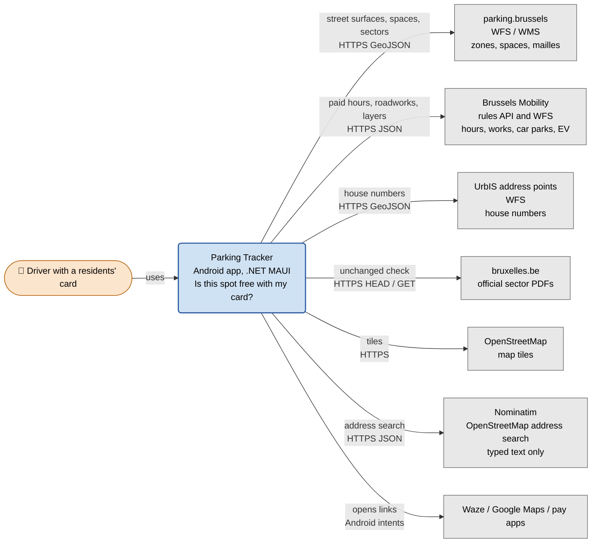
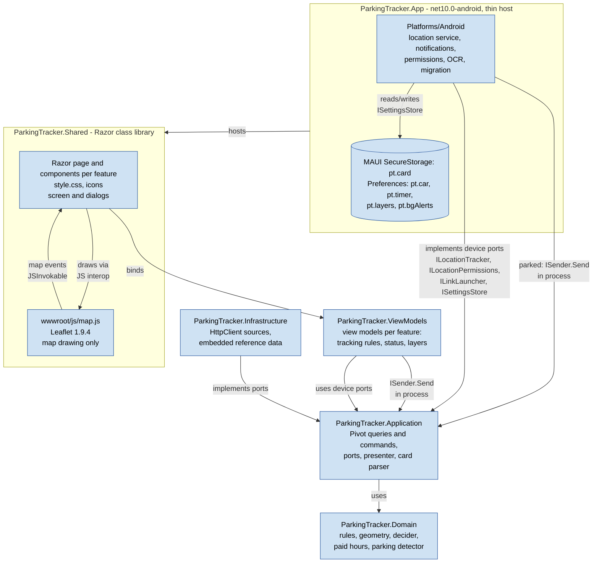
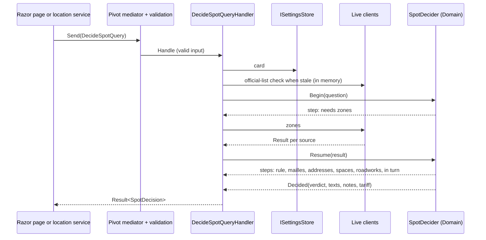
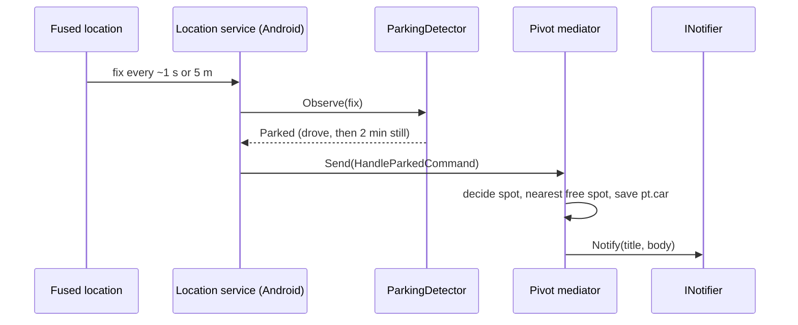

# Parking Tracker architecture (.NET MAUI migration proposal)

Status: proposal for branch `chore/maui-migration`, 2026-11-16. The decisions are in [the ADRs](adr/README.md), all
`Proposed`; this page describes the resulting design and how to get there.

## 1. Scope and inputs

The work moves the existing Android app to .NET 10 and .NET MAUI without changing what it does. There is no separate
functional analysis: the current code is the specification.

| Input | What it defines |
| --- | --- |
| `README.md` | Features, the 19 municipalities, data sources, how the app decides |
| `live.js` | All live data access and the decision engine |
| `app.js`, `index.html`, `style.css`, `icons.js` | Screen, map layers, card/car/timer dialogs, permissions, OCR |
| `municipalities.js`, `city-sectors.js`, `sectors.js` | Reference data (City data generated by `tools/build_city_sectors.py`) |
| `android/`, `capacitor.config.json` | Application id, signing, permissions, `LocationAccessPlugin` |
| `.github/workflows/android.yml`, `tools/emulator-test.mjs` | Build, emulator test, release |

Decisions already made by the owner: Pivot.Framework; MAUI Blazor Hybrid reusing the HTML/CSS and Leaflet; Android
only; install as an update (id `be.parkingtracker.app`, same key, versionCode above 11); keep the saved card.

Assumptions:

| Assumption | If wrong |
| --- | --- |
| Pivot packages 2.1.0 stay readable with the workflow token (public packages) | CI needs a personal access token secret with `read:packages` |
| The installed phone has a 64-bit ARM CPU and Google Play services | A 32-bit-only phone needs `android-arm` in the APK (planned, see section 7); without Play services there is no position (ADR-0002) |
| Capacitor's WebView origin is `https://localhost` | The migration in ADR-0004 finds nothing; the upgrade test fails and shows it |
| Nobody uses the web version | GitHub Pages is not enabled for the repository (checked), so no published site disappears |

## 2. Quality attributes

| Attribute | Target | Where it is argued |
| --- | --- | --- |
| Correctness | Same answers as `live.js` on recorded data; never FREE without live confirmation | 3.2, 6.3 |
| Honesty | Any missing source, GPS worse than ±25 m or older than 15 s, or offline gives CAN'T VERIFY | 5.2 |
| Latency | One check stays within the current per-source timeouts (12 s, 30 s for City PDFs) | 5.2 |
| Background | Parking alert within about 2.5 minutes of stopping, app off screen | ADR-0002 |
| Update safety | The new APK installs over v1.0.11 and keeps the card | 7, ADR-0004 |
| Release safety | No release unless the emulator test passes on the same Release code | 6.3, 7 |
| Privacy | Card and car data stay on the phone; only coordinates and bounding boxes go to the public APIs | 6.1 |
| Local verifiability | Domain, Application and Infrastructure build and test on a PC without Android tooling | 3.1, 6.3 |

## 3. Architecture decisions

### 3.1 Architecture pattern and Pivot usage

Pivot's patterns A to D (outbox CQRS, event history, sagas, CRUD aggregates) describe services with a database. This
app has no database, no aggregates with identity and no messaging, so none applies. It uses Pivot's in-process CQRS
only: read-side queries for every decision, and small commands for the settings. This is a deliberate deviation from
the house service frame (SQL Server, Keycloak, RabbitMQ, Blazor Server), which applies to services, not to an offline
mobile client; it needs the owner's acceptance through ADR-0001.

| Package (2.1.0) | Used for | Project |
| --- | --- | --- |
| `Pivot.Framework.Domain` | `Result`, `Result<T>`, `Error` | Domain, Application |
| `Pivot.Framework.Application` | `IQuery<T>`, `ICommand`, handlers, `AddPivotMediator`, `ValidationPipelineBehavior` | Application, App |
| `Pivot.Framework.Tools.DependencyInjection` | `IServiceInstaller` per layer | Application, Infrastructure, App |

Excluded: `Infrastructure.*` (EF Core, SQLite, PostgreSQL, outbox, RabbitMQ, Redis, MongoDB, Hangfire),
`Containers.*` and `Authentication.*`. Pivot 2.x replaced MediatR with its own mediator; there is no MediatR or
AutoMapper dependency. The installed `pivot-application` skill still describes MediatR: the source is the reference.

Illustrative only (C#, Pivot.Framework 2.1.0 APIs verified in the source; not a scaffold):

```csharp
public sealed record DecideSpotQuery(double Latitude, double Longitude, double? AccuracyMeters)
    : IQuery<SpotDecision>;

services.AddPivotMediator(options => options
    .RegisterServicesFromAssemblyContaining<DecideSpotQuery>()
    .AddOpenBehavior(typeof(ValidationPipelineBehavior<,>)));
```

### 3.2 What moves to C#, what stays in JavaScript

Options: (a) port everything except map drawing; (b) keep `live.js` and call it from C#; (c) port the engine but let
JavaScript fetch the map layers. Option (a) wins: (b) keeps the untested engine and CORS problems; (c) fails because
parking.brussels does not allow calls from a page origin (the reason for today's dev-server proxy).

| Concern | Today | After |
| --- | --- | --- |
| Geometry (Web Mercator, point in ring, closest point) | `live.js` | Domain `Geometry` |
| House numbers and street-list rules (`parseHouse`, `parseRule`, `ruleCovers`, `check:`) | `live.js` | Domain `StreetRules` |
| Sector model, tolerance codes, street lookup | `live.js` | Domain `Sector` |
| Zone types, card scope per municipality kind, tunnel exclusion | `live.js` | Domain `ZoneClassifier`, `CardScope` |
| Paid hours, Brussels time, Belgian holidays, tariff text | `live.js` | Domain `PaidHours`, `BelgianHolidays` |
| Decision (`decide`, `decideZone`, `surfaceStatus`, free spots) | `live.js` | Domain `SpotDecider`, `SpotAnnotator`, `SurfaceStatusEvaluator`, `AreaDecider` (pure) and Application handlers that fetch what the decider asks for |
| Texts (headlines, details, notes) | `live.js`, `app.js` | Domain `SpotDecision` and the decider: the same English sentences as plain text (see below) |
| Parking detector | `app.js` | Domain `ParkingDetector` (ADR-0002) |
| Card text parsing | `app.js` | Application `CardTextParser` (ADR-0003) |
| Live sources over HTTP | `fetch` / CapacitorHttp | Infrastructure clients on `HttpClient` |
| Saved data | `localStorage` | `ISettingsStore`: card in MAUI `SecureStorage`, other keys in `Preferences` (ADR-0004) |
| Screen, dialogs, sheet, toasts | DOM code | Razor components using the same markup and `style.css` |
| Map, markers, polygons, WMS, popups | Leaflet | Leaflet in `wwwroot/js/map.js` |

Domain results carry no HTML: a verdict (`Free`, `FreeNow`, `Pay`, `Reserved`, `TimeLimited`, `ParkingDisc`,
`CheckNumber`, `CheckCard`, `CheckSigns`, `CantVerify`) that gives the headline and the colour, and the
explanation, notes and tariff as plain text identical to `live.js` minus its `<b>` tags and HTML escaping. There is
no separate presenter: the sentences are built where the decision is made, which keeps them next to the facts they
state and lets the parity tests compare them one to one. Emphasised segments (the `<b>` parts) are not modelled; the
screen stage adds them only if the design needs them.

The decider is pure and does no input or output. A decision is a chain of `DecisionStep` values: each asks for one
source (`NeedZones`, `NeedRule`, `NeedMailles`, `NeedAddresses`, `NeedSpaces`, `NeedWorks`) together with what to do
with the outcome, or is the answer (`Decided`). `IDecisionStepRunner` in Application fetches what a step asks for
through the ports and passes the result back, success or failure. A source is only asked when the decision needs
it, in the order of `live.js`, so a source that is not needed cannot make the answer fail.

### 3.3 The JavaScript interop boundary

One ES module, `wwwroot/js/map.js`, loaded with `IJSRuntime.InvokeAsync<IJSObjectReference>("import", ...)`, owns the
Leaflet map. Leaflet 1.9.4 is shipped in `wwwroot/lib` instead of loaded from unpkg, so the app starts offline.

| Direction | Calls |
| --- | --- |
| C# to JS | `init(element, view, callbacks)`, `setView`, `setViewAtLeast`, `fitBounds`, `setMe(lat, lon, accuracy)`, `setPin`, `setCar`, `openCarPopup`, `setTarget`, `drawSurfaces(layer, items)`, `drawPoints(layer, items)`, `showZonesWms(on)`, `clear(layer)` |
| JS to C# (`DotNetObjectReference`, `[JSInvokable]`) | `OnMapClick(lat, lon)`, `OnPinMoved(lat, lon)`, `OnViewChanged(south, west, north, east, zoom)`, `OnPopupAction(kind, id)` |
| Housekeeping | `observeSheet(element)` keeps `--sheet-h` equal to the bottom sheet height; `dispose()` removes the map and every reference, and the component disposes the module and the `DotNetObjectReference` |

Payloads are compact: polygons as arrays of `[lat, lon]` rounded to 6 decimals, a style key per surface (`covered`,
`mixed`, `pay`, …) and popup text already escaped by C#. Map-drawing code holds no rules: colours per style key stay in
`map.js` as today's `KIND_STYLE`. Navigation links (Waze, Google Maps, pay apps, e-mail) open through MAUI `Launcher`.

Texts from services never become markup in the script: a marker label is set with `textContent` (and escaped by C#), and the popup
buttons are handled by one delegated click listener on the map container, registered in `init` and removed in `dispose()`.
The position source (`ILocationTracker`) may raise its events on any thread and must keep delivering fixes while the device
stands still, because the main screen reports a lost signal after 15 seconds without a fix.

### 3.4 Reference data

Options: (a) embedded JSON written by the Python tools; (b) generated C# source; (c) download at run time. Option (a)
wins: the data stays diff-able and readable by Python, needs no C# generator, and keeps working offline; (b) makes the
Python tools emit C#, and (c) adds a new hosting need and a new failure mode.

| Today | After | Written by |
| --- | --- | --- |
| `city-sectors.js` | `src/Infrastructure/ParkingTracker.Infrastructure/Data/city-sectors.json` | `tools/build_city_sectors.py` (same `--check` mode) |
| `sectors.js` | `.../Data/tolerance-sectors.json` | by hand, checked by `tools/verify_sectors.py` |
| `municipalities.js` | `.../Data/municipalities.json` | by hand |

The JSON keeps today's shapes (`[fr, nl, odd, even, postcode]` rows, `sources` with url, etag, length, lastModified,
sha256). A `ReferenceDataProvider` loads them once as embedded resources; tests check that every file loads, that each
City source has a SHA-256, and that the street counts per sector equal those of the JavaScript files at cut-over.

`ReferenceDataProvider` implements the port `IReferenceData.GetReferenceData()`, which returns a
`Result<ReferenceDataSet>`; a missing or invalid file gives `ReferenceData.ResourceMissing` or
`ReferenceData.InvalidFormat`. `tolerance-sectors.json` keeps the shape of `sectors.js` (a `louise` object with
`streets`, `sources` and `tolerances`); `tools/verify_sectors.py` reads it. Until cut-over
`tools/build_city_sectors.py` also writes `city-sectors.js` for the web app, and `tools/verify_sectors.py` also checks
that the shipped `sectors.js` and `municipalities.js` agree with the JSON.

An empty side cell has two meanings: in a sector's street list it means the whole side is covered, in a tolerance
agreement it means the side is not covered. `SectorStreet.EmptyMeansWholeSide` carries this, set by the reader from
where the row comes from.

### 3.5 Android platform services and OCR

Background location, parking alerts, timer notifications and the permission flow: ADR-0002 (own foreground service on
platform APIs). Card photo recognition: ADR-0003 (MediaPicker and ML Kit). Saved data: ADR-0004.

The main activity keeps the Java name `be.parkingtracker.app.MainActivity`
(`[Activity(Name = "be.parkingtracker.app.MainActivity", MainLauncher = true)]`). Otherwise .NET generates a
`crc64…` name, home-screen shortcuts to the old component break, and the emulator test's `am start` fails.

## 4. Component and deployment model

The deployed system is one APK on the phone, talking to public services over HTTPS.



Inside the app, dependencies point inward: the thin MAUI host composes everything, Infrastructure and the Android code
implement Application ports, Domain depends only on `Pivot.Framework.Domain`. The screens live in a Razor class library
(`ParkingTracker.Shared`) that the host references, so that they can be tested on any operating system.



Solution layout (the Pivot.Framework canonical layout, adapted to a mobile client in
[ADR-0006](adr/0006-mobile-client-layout.md)). Every project is organised in feature folders (`Features/<Feature>/`,
with `Features/Shared/` for what several features use); the test tree mirrors `src/`:

```text
ParkingTracker.slnx                everything that builds on any PC (the host is not in it)
global.json                 SDK 10.0.4xx, rollForward latestFeature
Directory.Build.props       net10.0, nullable, implicit usings, analyzers, StyleCop settings, XML docs
stylecop.json               documentation and using placement rules
.editorconfig               organizational analyzer baseline; test/.editorconfig narrows it for tests
Directory.Packages.props    central versions; Pivot.Framework.* pinned together
nuget.config                nuget.org + GitHub Packages, source mapping Pivot.* -> GitHub
src/
  Core/
    ParkingTracker.Domain          Features/{Cards,Cars,Sectors,Zones,PaidHours,ParkingDetection,SpotDecisions,MapLayers,AddressSearch,Shared}
                                   each with ValueObjects/, Services/ (and Errors/ when needed)
    ParkingTracker.Application     Features/SpotDecisions/{Queries,Services,Abstractions}
                                   Features/Sectors/{Queries,Services,Abstractions}
                                   Features/MapLayers/Queries, Features/AddressSearch/{Queries,Abstractions}
                                   Features/Shared/Abstractions (ISettingsStore, ILinkLauncher, ILocationPermissions)
  Infrastructure/
    ParkingTracker.Infrastructure  Features/{Zones,PaidHours,Sectors,AddressSearch,Shared/Http,Shared/Parsing}
                                   Data/*.json (embedded resources)
  Containers/
    UI/
      Core/
        ParkingTracker.Shared      Razor class library: Features/<Feature>/Pages and Components/<Name>/, Features/Shared/{Layout,Components},
                                   wwwroot/{css,js,lib/leaflet}
        ParkingTracker.ViewModels  Features/{SpotCheck,Card,Car,MapLayers,Welcome,Shared}: view models and the pure UI rules
      Hosting/
        ParkingTracker.App         thin .NET MAUI Blazor Hybrid host (net10.0-android only): MauiProgram, AppServiceInstaller,
                                   Features/{Shared,SpotDecisions} (device ports), Platforms/Android, wwwroot/index.html
test/
  Containers/
    UI/
      Core/
        ParkingTracker.ViewModels.Tests   xUnit, NSubstitute, fake clock
        ParkingTracker.Shared.Tests       bUnit, JavaScript interop in strict mode
  Core/
    ParkingTracker.Domain.Tests
    ParkingTracker.Application.Tests
  Infrastructure/
    ParkingTracker.Infrastructure.Tests   Features/SpotDecisions/Parity holds the parity tests
  ParkingTracker.E2E.Tests         Node project: the Android emulator test (emulator-test.mjs)
  fixtures/                        recorded live responses and expected answers
tools/                      Python data tools, emulator test, parity recorder
```

Each layer has one installer (`ApplicationServiceInstaller`, `InfrastructureServiceInstaller`,
`AppServiceInstaller : IServiceInstaller`) called from `MauiProgram`. Scrutor-based convention scanning
(`BaseServiceInstaller`) is used only for Application and Infrastructure; Android services are registered by hand.
Release builds keep the default partial trimming; full trimming and NativeAOT stay off because the mediator and the
scanning use reflection.

### 4.1 Build the .NET solution

The `Pivot.Framework.*` packages come from GitHub Packages, so restore needs a token. Set two environment variables
in the shell that builds: `GITHUB_PACKAGES_USER` (the GitHub user name) and `GITHUB_PACKAGES_TOKEN` (a GitHub token
with the `read:packages` scope, for example the output of `gh auth token`). `nuget.config` reads them at restore time
and never stores them. Then build and test everything with `python .agent-kit/verify.py`.
The workflow `.github/workflows/dotnet.yml` does the same in CI: restore with the two variables filled from the
workflow actor and token, `dotnet format --verify-no-changes`, a Release build and the tests.

The host `src/Containers/UI/Hosting/ParkingTracker.App` builds only where the `maui-android` workload is installed, which
is the CI workflow `.github/workflows/maui-android.yml` (on pushes to `chore/maui-migration` and on demand, never a
release). It is therefore not in `ParkingTracker.slnx`, so `verify.py` and `dotnet.yml` stay free of Android tooling;
On a machine that has the workload, build the host csproj directly (`dotnet publish <csproj> -f net10.0-android -c Release`); a second solution file at the root would be picked up by `verify.py`. The workflow restores with the package token,
installs the Android SDK packages (`InstallAndroidDependencies`), publishes the Release APK twice, plain and with
`-p:EnableTestHooks=true`, both signed with the debug key and with `ApplicationVersion` = the run number (no release
reads it at this stage), and runs `test/ParkingTracker.E2E.Tests/emulator-test.mjs` on an API 34 emulator. The host
supports Android 7.0 (API 24) and later, because .NET MAUI 10 does; the Capacitor app supported API 23.

The live smoke tests (`LiveSourcesSmokeTests`) call each real service once around Avenue Louise 216. They are skipped by
default, so `verify.py` needs no network beyond the feed. Switch them on with the environment variable
`PARKING_LIVE_TESTS=1`, for example:

```bash
PARKING_LIVE_TESTS=1 dotnet test test/Infrastructure/ParkingTracker.Infrastructure.Tests \
  --filter FullyQualifiedName~LiveSourcesSmokeTests
```

### 4.2 Device ports and the screens

The phone is reached through four ports of the Application layer. The thin host implements them with MAUI and Android
APIs; the view models and the tests only see the interfaces.

| Port | Feature folder | What it does | Implemented by |
| --- | --- | --- | --- |
| `ILocationTracker` | `SpotDecisions/Abstractions` | Starts and stops high-accuracy fixes (`GpsFix`: position, accuracy, speed or none, time) and reports them and failures as events | host, fused location |
| `ILocationPermissions` | `Shared/Abstractions` | Reads the foreground and background permission, asks for the foreground one, opens the app's location settings for "Allow all the time" | host |
| `ILinkLauncher` | `Shared/Abstractions` | Opens an address (Waze, Google Maps, payment app, e-mail) outside the app | host, MAUI `Launcher` |
| `ISettingsStore` | `Shared/Abstractions` | Card, parked car, layer switches, welcome seen, location banner postponement | host, `SecureStorage` and `Preferences` |

`ISettingsStore` keeps the values of the first version of the app (`pt.card`, `pt.car`, `pt.layers`, `pt.permSnooze`), so
that stage 6 can copy them unchanged; the welcome flag `pt.welcomeSeen` is new and is not migrated. `ParkingCard` carries
the card number and plate next to the validity data, and `ParkedCar` the position, moment, headline and place.

The host implements the ports in `Features/<Feature>/` with thin MAUI classes: `GeolocationTracker` (continuous
foreground listening at best accuracy, one fix per second, no minimum distance), `MauiLocationPermissions`,
`MauiLinkLauncher`, `ConnectivityNetworkStatus` and `SecureValueStorage` / `PreferencesValueStorage`. Everything that can
be tested without a phone sits in `ParkingTracker.ViewModels`: `SettingsStore` and `SettingsJson` (the JSON of
`pt.card`, `pt.car`, `pt.layers`, `pt.permSnooze` exactly as `app.js` wrote it; a card without a municipality reads as
`bruxelles`), the vibration pattern and the test hooks. `PlatformRelay`, a component without markup in the second root
of the web view, joins phone events to the view models, which live in the scope of the web view: a change of connection
goes to `SpotCheckViewModel.HandleConnectivityChangeAsync`, a return to the app to `LocationPermissionViewModel.RefreshAsync`,
a change between covered and not covered to a vibration. Preferences use their own file (`parkingtracker`), so that the
backup rules can exclude the encrypted card file alone.

The screens are split in two projects. `ParkingTracker.ViewModels` holds everything that is not markup and needs no
browser: the tracking rules (a fix older than 15 s is ignored; a new check after 8 m, 30 s or the first accurate fix; the
nearest-spot search again after 60 m or 60 s, always for a pin), the status block per verdict, the card line with the
30-day expiry warning, the layer zoom levels (zone image zoomed out, street colours from 15, house-number detail from 16,
spaces from 17), the 700 ms layer debounce and the official-list recheck. View models send queries through `ISender` and
use the ports; they have no MAUI type. `ParkingTracker.Shared` holds the Razor page, the components, `style.css`, the icon
component and `wwwroot/js/map.js`; every component sits in its own folder with a code-behind. The map module and its
Leaflet 1.9.4 files ship inside the class library (`_content/ParkingTracker.Shared/`), and `MapScript` is the typed face of
the module's functions.

## 5. Data and integration design

### 5.1 Domain types

| Type | Kind | Invariants and notes |
| --- | --- | --- |
| `GeoPoint` | record struct | Degrees only; the range check (latitude -90..90, longitude -180..180) is done where coordinates enter, by the query validator |
| `GpsFix` | record | Point, accuracy (m), speed, time; the accuracy rule (≤ 25 m) is in `SpotDecider`, the age rule stays with the `ParkingDetector` |
| `HouseNumber`, `HouseRange` | records | Number plus optional lower-case letter; `LowKey`/`HighKey` as `keyLow`/`keyHigh`; a range is a pair of keys |
| `SideRule`, `SideRuleKind`, `EmptyCellMeaning`, `StreetSide` | record, enums | `All`, `None`, `Ranges` or `Condition` (`check:` text); `SideRule.Parse` returns `Result` (`SideRule.InvalidRange` for an unreadable range, where `live.js` throws) and reads an empty cell by an `EmptyCellMeaning` taken from the row's `EmptyMeansWholeSide` |
| `RuleSet`, `StreetRules`, `ToleranceRule`, `SectorModel` | records, class | The parsed rules per street; `SectorModel.Build` returns `Result` (`Sector.InvalidRule`); street lookup by normalised French and Dutch name; `RuleSetsFor` applies sector rules only in the City of Brussels and tolerance rules only in their municipality with the card's code |
| `GeoBox`, `MercatorPoint`, `SurfaceShape`, `ClosestPoint` | record structs, record | Web Mercator conversions, distance, point-in-ring, closest point and bounds of a street surface; `SurfaceFilter` excludes tunnels and viaducts |
| `SectorDefinition`, `SectorStreet`, `ToleranceAgreement` | records | From reference data; lookup by normalised French and Dutch names |
| `Municipality`, `MunicipalityKind` | record, enum | `Streets`, `Mailles`, `Whole`, `Wsl`, `Unknown` |
| `ParkingCard` | record | Municipality, sector, tolerances, mailles, lims and the validity dates (`CardPeriod`); `CardState` says valid, or why not. The card number and plate are optional fields of the record, kept as typed (plate in capitals); the `pt.card` JSON is the settings store's job |
| `ZoneSurface`, `ZoneType`, `ParkingRule` | record, enum, record | Live data; `ZoneType`: `Free`, `Payable`, `Derogation`, `Disk`, `Residents`, `Reserved`; `ZoneClassifier` gives the type and detects events; `PaidHours`, `BelgianHolidays`, `BrusselsTime` and `TariffText` answer paid-now, next start and the tariff text from `ParkingRule`. `ZoneSurface` reads the rule code from `ZoneId1`, or `zoneid1` when that is missing |
| `SectorMaille`, `ReservedSpace`, `AddressPoint`, `AssignedAddress`, `WorkItem` | records | Live data from the other sources; `AddressAssigner` ties address points to the street surface they face (corner ambiguity and number outliers left out) |
| `DecisionContext`, `SpotQuestion`, `DecisionStep` | records | What a decision knows (card, municipality, street lists, official-list status), the question (place, accuracy, moment, online) and the chain of steps described above |
| `SurfaceStatus`, `SurfaceKind`, `FreeSpot` | records, enum | Per-surface status for the map layer and the nearest covered spots (`AreaDecider`) |
| `ParkingDetector` | class | Fed `GpsFix` values and asked `GetParkedFix(now)` and told `AcknowledgeParked()`; no clock inside |
| `SpotDecision`, `Verdict`, `SpotStatus` | record, enums | Verdict (headline and colour), plain-text detail, notes, tariff, the zone reading (surface, rule, why the rule is missing) and the reserved space; `CantVerify` carries why in its detail |
| `ParkedCar`, `LayerSettings` | records | Same JSON as `pt.car` and `pt.layers`; `ParkingTimer` (`pt.timer`) comes with stage 6 |
| `CarPark`, `ChargingPoint`, `MailleOption`, `AddressMatch` | records | Map layer markers, the sector list of the card form and the address search answer; values are kept as the services wrote them because the map only prints them |
| `OfficialListStatus` | record | `Ok`, `Changed`, `Unverified`, checked time; re-check every 6 h, after 1 min when not ok. Kept in memory by `IOfficialListChecker` (singleton), not persisted; the comparison rules (headers, content hash, PDF signature) are in the record |

Expected failures use Pivot `Result`/`Error` with dotted codes (`ParkingBrussels.Unavailable`, `Urbis.BadResponse`,
`City.DocumentChanged`). A failed source is not a failed query: the handler turns it into a `CantVerify` decision,
because the user must see that answer. `Result.Failure` from a query means invalid input (for example coordinates out
of range, caught by `ValidationPipelineBehavior`).

### 5.2 Live sources

| Port | Source | Timeout |
| --- | --- | --- |
| `IParkingBrusselsClient` | `ows.parking.brussels` WFS: `GetZonesAsync` (`regulation_zones`), `GetSpacesAsync` (`on_street`), `GetMaillesAsync` (`permit_secteurs_mailles`), `GetMailleOptionsAsync` (the same layer without shapes: zone code and names, for the card form) | 12 s |
| `IAddressPointsClient` | `data.mobility.brussels` `bm_urbis:urbadm_adpt` | 12 s |
| `IParkingRulesClient` | `api.mobility.brussels` `regulations_rules`, per zone code or all, at a moment | 12 s |
| `IMobilityLayersClient` | `data.mobility.brussels` roadworks and events (`GetWorksAsync`), car parks (`bm_parking:parkingpublic`, `GetCarParksAsync`) and EV charging (`bm_equipment:evse`, `GetChargersAsync`) | 12 s |
| `IAddressSearch` | `nominatim.openstreetmap.org` search, `countrycodes=be`, bounded to the Brussels box, `Accept-Language: fr`, best match only; only the typed text is sent | 12 s |
| `ICityDocumentsClient` | `www.bruxelles.be` PDFs: `GetHeadersAsync` (HEAD), then `DownloadAsync`, which returns whether the content is a PDF and its SHA-256, not the bytes, when headers differ | 12 s / 30 s |

Two small ports complete the decision: `INetworkStatus` (online or not) and `ISettingsStore` (section 4.2). Request addresses, response
parsers and the HTTP-status failure live in Infrastructure as pure code (`SourceRequests` and `SourceResponse` under
`Features/Shared/Http`, the parsers under `Features/Shared/Parsing` and the feature folders), and the typed
`HttpClient` clients that use them (`ParkingBrusselsClient`, `AddressPointsClient`, `ParkingRulesClient`,
`MobilityLayersClient`, `CityDocumentsClient`, `NominatimClient`, internal to Infrastructure) are registered by
`InfrastructureServiceInstaller` with `IHttpClientFactory`. The limit of time is applied per call (`SourceTimeouts`:
12 s, 30 s for the PDF download), so a timeout (`<Source>.Timeout`, `<name> timed out`) is told apart from the caller's
cancellation, which is always rethrown; a lost connection gives `<Source>.Unavailable` (`<name> unreachable`). Requests
carry the generic User-Agent `ParkingTracker/1.0` and `Cache-Control: no-cache, no-store`. `ICityDocumentsClient` only
fetches (HEAD returns any status; the download returns the PDF flag and SHA-256); the comparison stays in
`OfficialListChecker`. A parser that cannot read an answer gives
`<Source>.BadResponse` with the message `<name>: unexpected answer`; an HTTP error gives `<Source>.Unavailable` with
`<name> HTTP <status>`, as `live.js` worded them.

Rules kept from `live.js`: no caching between checks (`no-store`), no retries (a timeout gives CAN'T VERIFY), WFS
requests with `srsName=EPSG:3857` and an EPSG:4326 bounding box, tunnels and viaducts excluded, disabled surfaces
ignored. Typed clients are registered with `IHttpClientFactory`; Android uses its native message handler. GeoJSON is
read with `System.Text.Json` into small DTOs; NetTopologySuite is not needed for the few geometry operations used.
Connectivity comes from MAUI `Connectivity` through an `INetworkStatus` port; time from `TimeProvider`.

### 5.3 Spot decision flow

The main read path: a GPS fix or a pin becomes one query; the pure decider asks for its sources one step at a time, in
the same order as today, and ends with the verdict.



### 5.4 Background parking alert



### 5.5 Persisted data

Only the six settings keys of ADR-0004, plus `pt.migration`. Their JSON is a contract with existing installs: changing
a shape later needs a versioned reader.

## 6. Cross-cutting concerns

### 6.1 Security and privacy

No sign-in, no back end, no secrets in the app. The card stays on the phone. Requests carry coordinates and bounding
boxes only, as today, with a generic `User-Agent`. Cleartext HTTP stays off. Popup and status texts are escaped by
Razor or by C# before they reach Leaflet. Release signing secrets stay in GitHub secrets.

### 6.2 Observability and resilience

`Microsoft.Extensions.Logging` to logcat; the emulator test keeps logcat. Unhandled .NET exceptions and Blazor's error
UI count as test failures. Resilience is honesty, not retries: any failed source gives CAN'T VERIFY with the reason.

### 6.3 Test strategy

| Level | What | Where | Runs |
| --- | --- | --- | --- |
| Unit | Geometry, street rules, holidays (fixed years incl. Easter), paid hours across DST, zone types, card scope per municipality kind, parking detector with synthetic tracks, card text parser | `test/Core/ParkingTracker.Domain.Tests`, `test/Core/ParkingTracker.Application.Tests` | locally and CI |
| Parity | For 17 recorded places (Avenue Louise 216, Place du Châtelain with a City card and with two mailles cards, Etterbeek, Uccle, Saint-Josse, a tunnel, a red zone, a reserved space, a `check:` street, a limit between house numbers, outside paid hours, a holiday, City list changed, a failed source, poor GPS) plus a free-spot search and two map areas: the C# answer equals the `live.js` answer, and the C# code asks for exactly the requests `live.js` made | `test/fixtures/parity`, `test/Infrastructure/ParkingTracker.Infrastructure.Tests/Features/SpotDecisions/Parity` (they need the parsers and the handlers together) | locally and CI |
| Integration | Clients against recorded responses through a stub `HttpMessageHandler`: URLs, parsing, filters, timeouts, error mapping; reference data loading | `test/Infrastructure/ParkingTracker.Infrastructure.Tests` | locally and CI |
| Live smoke | Clients against the real services, trait `Live` | Infrastructure tests | on demand, not a gate |
| Device | Emulator test: Release APK with test hooks | `test/ParkingTracker.E2E.Tests/emulator-test.mjs` in CI (`tools/emulator-test.mjs` stays for the Capacitor workflow until cut-over) | every branch push (`maui-android.yml`), every main build from stage 7 |
| Upgrade | Capacitor build, then MAUI build over it | CI job | until cut-over, then on demand |

Stack: xUnit, FluentAssertions, NSubstitute (owner's choice; FluentAssertions 8 has a commercial licence for commercial
use), `Microsoft.Extensions.TimeProvider.Testing` for the clock. Test names `Method_Scenario_ShouldExpectation`.

The parity fixtures are recorded once by `tools/parity/record.mjs` (`node tools/parity/record.mjs`, network needed;
`--dry` prints the answers without writing): it runs `live.js` in Node 22 or later with `window`, `navigator` and
`fetch` stubbed and a fixed clock per scenario, and writes into `test/fixtures/parity/<scenario>/` a `scenario.json`
(the inputs, the answer `live.js` gave as status, title, plain-text detail, notes and tariff, and the result of the
official-document check) and one `<hash>.json` per HTTP request, keyed by method and address. City PDFs are stored as
their SHA-256 and a PDF flag, not as bytes. Two scenarios use simulated answers, marked `simulated`: parking.brussels
answering HTTP 500, and the City answering with a different document. The parity tests replay the files through fake
ports that build each address with the production `SourceRequests`, so a request that `live.js` did not make fails the
test, and so does one it made that the C# code did not. The recorder and `live.js` are deleted at cut-over; the fixtures
stay as regression data.

Emulator test changes:

- The test APK is the Release configuration published with `-p:EnableTestHooks=true`. That constant enables WebView
  debugging and registers `window.ptTest`, which calls `[JSInvokable]` C# hooks. The release APK is built without it.
  Trimming and AOT are the same as in the published build.
- Steps kept: install with `-g`, grant permissions, launch, find the `webview_devtools_remote_<pid>` socket, CDP. The test
  lives in `test/ParkingTracker.E2E.Tests` (Node 22 built-ins only, see its README).
- The hook logic is plain C# in `ParkingTracker.ViewModels` (`TestHookService`, `TestHookScript`) with unit tests; only the
  `[JSInvokable]` bridge and the registration in `PlatformRelay` are conditional on the `TEST_HOOKS` constant, and the host
  project leaves those files out of a build without `EnableTestHooks`.
- `localStorage` seeding becomes `ptTest.setCard(json)`; `window.PT.decide` becomes `ptTest.decide(lat, lon, acc)`;
  `liveFreeSpots` becomes `ptTest.freeSpots(...)`; the plugin check becomes `ptTest.platformStatus()` (service,
  notification permission, foreground and background location).
- The on-screen check reads `.hero-title` and `.hero-sub`, which the Razor markup keeps.
- New checks (done in stage 5b): no .NET unhandled exception in logcat and the Blazor error UI hidden. Still to come in
  stage 6: a background parking alert: drive the
  emulator GPS above 20 km/h, stop, press Home, wait about 2.5 minutes, read `dumpsys notification` for the alert.
- Upgrade job: build the Capacitor app from the last Capacitor commit with `webContentsDebuggingEnabled` and a
  throwaway key, build the MAUI test APK with the same key, install the first, store a card through CDP in
  `https://localhost`, install the second with `install -r`, check `ptTest.getCard()` and the welcome dialog.

## 7. Infrastructure footprint and platform dependencies

No servers. CI on GitHub-hosted Ubuntu runners, same workflow file `.github/workflows/android.yml`:

| Job | Steps | Permissions |
| --- | --- | --- |
| build | checkout; `setup-dotnet` from `global.json`; `setup-java` 21; `dotnet workload install maui-android`; Android SDK platform 36 (`InstallAndroidDependencies` target); restore with `nuget.config` whose GitHub Packages credentials read `%GITHUB_TOKEN%`-style environment variables; `dotnet test` on the test projects; `dotnet publish` of the signed APK and of the test-hooks APK | `contents: read`, `packages: read` |
| test | emulator API 34, `node tools/emulator-test.mjs` | `contents: read` |
| upgrade-test | as section 6.3, until cut-over | `contents: read` |
| release | only on `main`, only if the tests passed; `gh release create v1.0.<run_number>` | `contents: write` |

Signing and version (illustrative MSBuild properties for `dotnet publish -f net10.0-android -c Release`; check the
names against the .NET 10 Android documentation when implementing):

```text
ApplicationId=be.parkingtracker.app
ApplicationVersion=$VERSION_CODE              # github.run_number, must stay above 11
ApplicationDisplayVersion=1.0.$VERSION_CODE
AndroidPackageFormats=apk
RuntimeIdentifiers=android-arm;android-arm64;android-x64
AndroidKeyStore=true
AndroidSigningKeyStore=$ANDROID_KEYSTORE_PATH
AndroidSigningKeyAlias=$ANDROID_KEY_ALIAS     # parkingtracker
AndroidSigningKeyPass=env:ANDROID_KEY_PASSWORD
AndroidSigningStorePass=env:ANDROID_KEYSTORE_PASSWORD
SupportedOSPlatformVersion=24                 # .NET MAUI 10 minimum; the Capacitor app had 23
```

Guards added to the build job:

- `github.run_number` is per workflow file: renaming or replacing `android.yml` restarts it at 1 and breaks updates.
  The build fails if `VERSION_CODE` is not above the versionCode of the latest release's APK (`aapt2 dump badging`).
- The build fails if the signing certificate SHA-256 of the new APK differs from the latest release's APK
  (`apksigner verify --print-certs`).
- Third-party actions are pinned to commit SHAs; each job has `timeout-minutes`; release never runs on a branch build.

Locally, `.agent-kit/config.json` gets a `verify` list that runs `dotnet test` on the three test projects, because
`verify.py` would otherwise build the whole solution, including the MAUI project, which needs the Android workload.

## 8. Decision index

| ADR | Decision | Why |
| --- | --- | --- |
| [0001](adr/0001-migrate-to-dotnet-maui-blazor-hybrid.md) | MAUI Blazor Hybrid on Pivot.Framework; logic in C#; JSON data; parity tests; retire PWA | Owner's goal, keeps the design, makes the engine testable |
| [0002](adr/0002-use-own-android-foreground-service-for-location-and-notifications.md) | Own foreground service, fused location, AlarmManager | Full control of background behaviour, one dependency |
| [0003](adr/0003-read-card-photos-with-ml-kit-on-device.md) | MediaPicker and ML Kit | Fast, offline, no CDN |
| [0004](adr/0004-migrate-saved-data-from-the-capacitor-webview-once.md) | One-time copy from the old WebView origin to Preferences | Keeps the card across the update |

Left out on purpose: local database, caching of live data, offline answers, iOS, a web version, sign-in. Any of them
would need its own ADR.

## 9. Migration and rollout

Nothing reaches users until the branch is merged into `main`, because only `main` publishes. The stages below are
separate pull requests into `chore/maui-migration` (or separate reviewed commits), each green before the next.

1. **Skeleton.** `global.json`, `Directory.*.props`, `nuget.config`, solution, the three class libraries and test
   projects, installers, `.agent-kit/config.json` verify list. Done when `python .agent-kit/verify.py` passes locally
   with Pivot 2.1.0 restored from GitHub Packages, and no non-selected Pivot package is in `project.assets.json`.
2. **Reference data.** Python tools write and read JSON; embedded resources and loader tests. Done when
   `python tools/build_city_sectors.py --check` and `python tools/verify_sectors.py` pass on the JSON, and the loader
   tests match the street counts of the JavaScript files.
3. **Domain and parity.** Port the rules and decider; record parity fixtures from `live.js`. Done when every parity
   scenario gives the same verdict, title and text as `live.js`, and holiday, paid-hours, geometry, rule and detector
   tests pass.
4. **Infrastructure.** HTTP clients and the official-list check. Done when fixture tests cover every source's URL,
   parsing, filters, timeout and error mapping, and the opt-in live smoke tests pass once by hand.
5. **App shell and UI.** Stage 5a (done): the device ports, the missing sources, `ParkingTracker.ViewModels`,
   `ParkingTracker.Shared` with `map.js` and the Leaflet files, and their tests. Stage 5b (written, to be proven by
   its first CI run): MAUI project, `MainActivity` name, the Android implementations of the device ports and of the
   settings store, the composition root, the test hooks, the E2E project and `maui-android.yml`. CI builds the APKs on
   the branch (push and `workflow_dispatch`, no release). Done when the emulator test's answer and screen checks pass
   on the new app.
6. **Platform services, OCR, migration.** ADR-0002, ADR-0003, ADR-0004. Done when the emulator test's background
   parking alert and timer checks pass and the upgrade test shows the card kept.
7. **CI and cut-over.** Final `android.yml` (version and certificate guards, test-hooks build, release on `main`
   only); delete `android/`, `capacitor.config.json`, `package.json`, `www` build, `sw.js`, `manifest.webmanifest`,
   `tools/dev-server.mjs`, `tools/build-web.mjs`, root JavaScript and data scripts; update `README.md` (install,
   build, test, data tools; remove web version) and create `CHANGELOG.md`. Done when the branch run is green and the
   owner installs the APK over v1.0.11 on the real phone and sees the card. Then the pull request to `main`; its
   first run publishes `v1.0.<run_number>` above 11.

Rollback: the previous APK cannot be installed over a higher versionCode without uninstalling. If the MAUI release is
broken, publish a fixed build; as a last resort rebuild the Capacitor code from the tag with a higher versionCode.

## 10. Risks and open questions

| Risk | Mitigation |
| --- | --- |
| Behaviour drift in the port | Parity fixtures from `live.js`; emulator answers at known places |
| Saved card lost on update | ADR-0004 migration, upgrade test, re-entry fallback |
| Update refused (versionCode or key) | Same workflow file, version and certificate guards |
| Release-only defects (trimming, AOT) | Test build is the Release configuration |
| Large map layers slow over interop | Compact payloads; measure at zoom 15 in the emulator; reduce by viewport if needed |
| OSM tiles refused from the new WebView origin | Screenshot check in the emulator test; set a tile `referrerPolicy` or user agent if needed |
| Android-only code not buildable locally | Keep it thin behind ports; CI on every branch push via `workflow_dispatch` |
| Pivot skill drift (MediatR) | APIs verified in `AnnabiGihed/Pivot.Framework` source and package 2.1.0 |

Owner answers (2026-11-16):

1. The phone has Google Play services; fused location applies (ADR-0002).
1. The workflow token is tried first for the Pivot packages (`permissions: packages: read`); a `read:packages`
   secret is added only if that fails.
1. The timer asks for the exact-alarm permission (ADR-0002).
1. The card is stored in `SecureStorage`, excluded from Android backup (ADR-0004).
1. Stages are reviewed commits on `chore/maui-migration`.
